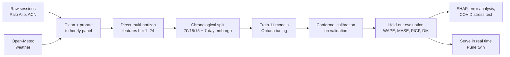
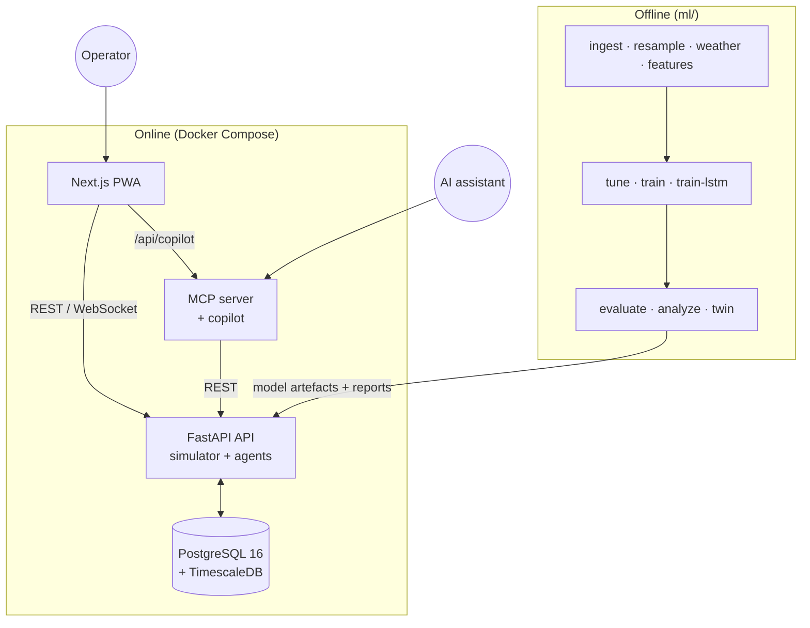

<div align="center">

# ⚡ P.O.W.E.R.

### Predictive Optimization of Wattage for EV Resources

**A real-time machine-learning system that forecasts EV charging demand 1–24 hours ahead, warns before transformers overload, and explains every forecast, deployed as a Pune pilot.**


*B.Tech Machine Learning course · Project Bank #41*

</div>

---

## 📑 Contents

1. [Problem statement](#-problem-statement)
2. [Solution at a glance](#-solution-at-a-glance)
3. [Results](#-results)
4. [Approach](#-approach)
5. [System architecture](#-system-architecture)
6. [Features of the console](#-features-of-the-console)
7. [Pune pilot deployment](#-pune-pilot-deployment-digital-twin)
8. [Tech stack](#-tech-stack)
9. [Repository structure](#-repository-structure)
10. [Getting started](#-getting-started)
11. [Configuration](#-configuration)
12. [Reproducing the results](#-reproducing-the-results)
13. [API, MCP server and copilot](#-api-mcp-server-and-copilot)
14. [Testing and quality](#-testing-and-quality)
15. [Advantages](#-advantages)
16. [Limitations](#-limitations)
17. [Responsible AI](#-responsible-ai)
18. [Future work](#-future-work)
19. [Documentation](#-documentation)
20. [References and acknowledgements](#-references-and-acknowledgements)
21. [License](#-license)

---

## 🎯 Problem statement

Electric-vehicle charging is growing quickly on distribution networks that were never planned for it. Drivers arrive at the same times of day, so a public charging site's load rises in sharp peaks. When several chargers draw power at once, the **local distribution transformer** can be pushed past its rating, which shortens its life and risks outages. Grid operators and charge-point operators therefore need to know, **hours in advance**:

- how much energy each site will draw in each of the next 24 hours, and how uncertain that is;
- which sites are likely to approach their capacity, and where demand could be moved instead;
- **why** the model expects a peak, so they can trust and act on the forecast.

Three properties make this harder than ordinary regression: demand is **zero in a third of all hours** and spiky in the rest, vehicles **stay plugged in after charging finishes** (16.7% of occupied port-hours are idle), and demand is **censored** when every port is full.

**Goal:** forecast hourly energy demand per charging site 1–24 hours ahead with calibrated 90% intervals, turn the forecasts into grid-risk alerts and reroute suggestions, explain each forecast, and run the whole loop in real time.

---

## 💡 Solution at a glance

| | |
|---|---|
| **Forecasting** | 11 models compared under a leakage-tested, chronological, direct multi-horizon protocol. Champion: **LightGBM quantile model**, using its median as the forecast |
| **Uncertainty** | Conformalized quantile regression gives **calibrated 90% intervals** per horizon |
| **Explainability** | Exact TreeSHAP for every forecast, as a waterfall chart and a plain-language sentence |
| **Grid risk** | q95 forecast ÷ assumed transformer rating → NORMAL / WARNING / CRITICAL, with hysteresis and greedy reroute suggestions |
| **Real time** | A simulation clock replays held-out data hour by hour: forecast → alert → explain → push to the browser in about **0.7 s per hour** |
| **Operations** | Agents for drift detection, gated champion–challenger retraining and station discovery |
| **Access** | Installable PWA, Web Push alerts, an MCP server for AI assistants and an in-app copilot |
| **Deployment** | Docker Compose: PostgreSQL 16 + TimescaleDB, FastAPI, Next.js, MCP. Live console set up as a **Pune pilot twin** |

---

## 📊 Results

The models were trained on public charging data from the City of Palo Alto (2017–2020, 259,415 sessions) and evaluated on a held-out period they never saw. The same frozen models were then evaluated on the **Pune pilot twin** (Pune sites, Pune weather, Indian holidays, IST), which is what the console shows.

| Model | WAPE (training city, held-out) | WAPE (Pune twin) | MASE (training city) | 90% coverage (training city) |
|---|---|---|---|---|
| B0 Persistence | 1.126 | 1.125 | 2.04 | 0.880 |
| B1 Seasonal naive (24 h) | 0.686 | 0.686 | 1.25 | 0.892 |
| B3 Hour-of-week climatology | 0.580 | 0.580 | 1.05 | 0.878 |
| M1 Ridge | 0.512 | 0.513 | 0.93 | 0.886 |
| M2 Random Forest | 0.501 | 0.509 | 0.91 | 0.888 |
| M3 XGBoost | 0.496 | 0.502 | 0.90 | 0.891 |
| M4 LightGBM (Tweedie) | 0.489 | 0.496 | 0.89 | 0.891 |
| M5 Seq2Seq LSTM | 0.510 | 0.520 | 0.93 | 0.877 |
| **M4 LightGBM q50 (champion)** | **0.468** | **0.475** | **0.85** | **0.893** |

**Headlines**

- 🏆 The champion is **31.8% more accurate than seasonal naive** (WAPE 0.468 vs 0.686), and better than every other model at both 1-hour and 24-hour horizons. Diebold–Mariano tests with Holm correction give p < 10⁻⁵.
- 🎯 Its 90% intervals cover **89.3%** of hours (target 87–93%).
- 🔍 SHAP shows that **weekly and daily usage patterns drive demand**; holidays are the largest source of error; weather explains about 0.1% of the forecasts.
- 🦠 On the COVID-19 collapse (March–June 2020), error doubled while coverage *rose*. A CUSUM drift detector on forecast bias still raised the first alarm **9 days before** the regional lockdown order.
- 🔁 The first live champion–challenger retrain improved WAPE by 1.9%, short of the 2% gate, and was **correctly not promoted**.

> Pune-twin and training-city results are close because the twin keeps the training demand and changes only the local context (weather, holidays, time zone, sites). See [Limitations](#-limitations).

---

## 🧭 Approach



1. **Data.** Each session's energy is spread over the hours it was actually charging, giving a gap-free hourly panel per site (221,760 site-hours). Occupancy and idle time are rebuilt from the connection intervals. Weather comes from Open-Meteo.
2. **Features without leakage.** Every feature is either *known at forecast time for the target hour* (calendar, seasonal lags ≥ 24 h, weather) or *the state at the forecast origin* (recent load, occupancy). A future-poisoning test proves that no feature can see the future.
3. **Direct multi-horizon models.** One model per algorithm predicts every horizon, with the horizon as an input. Predictions are never fed back, so errors don't compound.
4. **A fair comparison.** All models use identical rows and calibration data. Results are reported per horizon, with significance tests. Every scoring of the test period is logged with a reason in `reports/test_evaluations.log`.
5. **Probabilistic and explainable.** Quantile LightGBM is calibrated with CQR, and SHAP values add up exactly to each forecast in kWh.

---

## 🏗️ System architecture



- **One shared feature library (`power_core`)** is used by training and serving, so features are computed the same way in both (no train/serve skew).
- **The API process** runs the simulation clock and the agents as the only writer to the database, and publishes events over a WebSocket.
- **The web app** never holds secrets: admin actions and copilot calls go through server-side routes.

---

## 🖥️ Features of the console

| Screen | What you can do |
|---|---|
| **Command Center** | Play the live clock, scrub +1…+24 h on a risk-coloured Pune map, see KPIs, alerts and reroute arcs |
| **Stations** | The 8 forecast pilot sites, highest risk first, and 26 other Pune chargers from OpenStreetMap shown as context with rough estimates |
| **Station detail** | 48 h of actuals, the 24 h forecast with a calibrated 90% band, the assumed capacity line, a SHAP waterfall for any hour, and a model switcher |
| **Model Arena** | Sortable leaderboard, error by horizon, rolling live accuracy |
| **What-If** | Change temperature, rain, holidays or demand and compare baseline vs scenario, with out-of-training-range warnings |
| **Insights** | SHAP drivers, where errors are largest, the COVID-19 stress test with drift alarms |
| **Ops** | Agent health, drift checks, retrain with promotion gate and rollback, station discovery, test push |
| **Copilot** | Ask in plain English; answers use only the system's own tools and cite them |

📲 Installable PWA with an offline page · 🔔 Web Push for new alerts · 🌗 dark and light themes · 📱 works at phone width.

---

## 🇮🇳 Pune pilot deployment (digital twin)

The live console serves **Pune**, while the models stay trained on the public US data (`configs/deployments/pune.yaml`):

- **Sites:** real public charging locations in Pune from OpenStreetMap, such as Westend Mall (Aundh), Balewadi High Street (Baner), Gokhale Path (Deccan Gymkhana), Paud Road (Erandwane) and Sahakar Nagar.
- **Context:** Pune's own observed weather, Indian and Maharashtra public holidays, and IST everywhere.
- **Demand:** each Pune site replays the held-out demand of a paired training site, aligned on local clock time (08:00 there becomes 08:00 IST). No public per-session Indian charging dataset exists.
- **Every section is Pune-based:** `power-ml twin` re-evaluates the models on the twin, and the API serves those results (`reports/pune/`) to the Arena, Insights, Ops and copilot.

The UI labels this a **pilot digital twin**: it shows how the system behaves in Pune's context; it is not a validation on Indian drivers.

---

## 🧰 Tech stack

| Layer | Technologies |
|---|---|
| ML | Python 3.12, pandas, NumPy, scikit-learn, XGBoost, LightGBM, PyTorch (LSTM), Optuna, TreeSHAP |
| Backend | FastAPI, SQLAlchemy 2 (async), PostgreSQL 16 + TimescaleDB (SQLite for local dev), WebSocket |
| Frontend | Next.js 15, React 19, TypeScript, Tailwind CSS v4, TanStack Query, MapLibre GL, Recharts, Serwist (PWA) |
| AI access | MCP Python SDK v2, Groq (`openai/gpt-oss-120b`) or Anthropic Claude for the copilot |
| Data sources | City of Palo Alto open data, Caltech ACN-Data, Open-Meteo, OpenStreetMap |
| Tooling | uv workspace, Docker Compose, pytest + hypothesis, ruff, ESLint |

---

## 📁 Repository structure

```text
P.O.W.E.R/
├── apps/
│   └── web/                     # Next.js 15 PWA (operator console)
│       ├── src/app/             # pages: /, stations, arena, simulator, insights, ops, api routes, sw.ts
│       ├── src/components/      # map, charts, KPI ribbon, alert feed, copilot panel, push toggle
│       └── src/lib/             # typed API client, formatting, live WebSocket layer
├── packages/
│   └── power_core/              # shared library: features, splits, metrics, conformal, drift, grid, deployment
├── ml/                          # offline pipeline (CLI: power-ml)
│   └── src/power_ml/            # ingest, resample, weather, models/, training, tuning,
│                                # evaluation, analysis, retrain, twin
├── services/
│   ├── api/                     # FastAPI service (CLI: power-api): DB, serving engine,
│   │                            # simulator, agents, routers, Web Push
│   └── mcp/                     # MCP server + in-app copilot (CLI: power-mcp)
├── configs/                     # data, features, models, thresholds; deployments/pune.yaml
├── reports/                     # evaluation results, figures; reports/pune/ for the twin
├── docs/                        # audit, system blueprint, technical report (.md + .docx)
├── scripts/report/              # Markdown → Word report generator
├── data/                        # (git-ignored) raw, interim, processed, external; manifest.json tracked
├── artifacts/                   # (git-ignored) trained models with manifests
├── docker-compose.yml           # db · api · web · mcp
├── Makefile                     # data pipeline and test shortcuts
└── pyproject.toml / uv.lock     # uv workspace and pinned dependencies
```

---

## 🚀 Getting started

### Prerequisites

- **Docker Desktop** (for the full stack), or **Python 3.12 + [uv](https://docs.astral.sh/uv/)** and **Node.js 20+** for local development.
- The git-ignored `data/`, `artifacts/` and `reports/` outputs, produced by [Reproducing the results](#-reproducing-the-results).

### Option A — Docker (recommended)

```bash
git clone https://github.com/aryanpol73/P.O.W.E.R.git
cd P.O.W.E.R
cp .env.example .env            # set ADMIN_TOKEN, POSTGRES_PASSWORD, optionally GROQ_API_KEY
docker compose up -d --build    # first start seeds PostgreSQL, then serves
```

| Service | URL |
|---|---|
| Console (PWA) | http://localhost:3011 |
| API docs | http://localhost:8011/docs |
| MCP server | http://localhost:8765/mcp |
| PostgreSQL | localhost:5433 |

Stop with `docker compose down`; add `-v` to also delete the database.

### Option B — Local development

```bash
uv sync --extra dl --extra postgres
npm --prefix apps/web install

uv run power-api seed                       # SQLite at data/power.db
uv run power-api serve --port 8011          # terminal 1

# terminal 2 (PowerShell syntax; on macOS/Linux: NEXT_PUBLIC_API_URL=... npm ...)
$env:NEXT_PUBLIC_API_URL="http://127.0.0.1:8011"; npm --prefix apps/web run dev -- -p 3011

# terminal 3 (optional): MCP server + copilot
$env:GROQ_API_KEY="your-key"; uv run power-mcp --transport http --port 8765
```

> The service worker (offline mode, Web Push) only runs in the production build: use Docker to try those.

---

## ⚙️ Configuration

All settings come from environment variables (`.env`, see `.env.example`) and YAML files in `configs/`.

| Variable | Default | Purpose |
|---|---|---|
| `DATABASE_URL` | SQLite | `postgresql+asyncpg://…` for PostgreSQL |
| `POWER_DEPLOYMENT` | `pune` | Live console city (`configs/deployments/<name>.yaml`); `none` = training sites |
| `SIM_MODE` | `REPLAY` | `REPLAY` (held-out data) or `LIVE_SHADOW` (aligned to today, live weather) |
| `ADMIN_TOKEN` | — | Protects admin actions (simulator, retrain, discovery) |
| `GROQ_API_KEY` / `ANTHROPIC_API_KEY` | — | Turns on the copilot (Groq or Claude) |
| `POWER_COPILOT_TOKEN` | — | Guards the copilot route between web and MCP |
| `VAPID_PUBLIC_KEY` / `VAPID_PRIVATE_KEY` | generated | Web Push keys |
| `POWER_TORCH` | `cpu` | Docker build: `none` skips PyTorch (the LSTM is then not served) |
| `POWER_WEB_PORT` / `POWER_API_PORT` / `POWER_DB_PORT` / `POWER_MCP_PORT` | 3011 / 8011 / 5433 / 8765 | Host ports |

Model, feature and alert settings (horizons, tuning, conformal level, thresholds, drift and retrain gates) are in `configs/models.yaml`, `features.yaml` and `thresholds.yaml`.

---

## 🔬 Reproducing the results

Every stage is deterministic (seed 42, pinned `uv.lock`, SHA-256-checked raw data, a manifest with the git SHA for every model).

```bash
# 1. Data: place the Palo Alto CSV in data/raw/ (see Datasets below), then
uv run power-ml ingest   --source palo_alto
uv run power-ml resample --source palo_alto
uv run power-ml weather  --source palo_alto
uv run power-ml panel    --source palo_alto
uv run power-ml features --source palo_alto

# 2. Leakage tests, tuning and training
uv run pytest -q -m leakage
uv run power-ml tune       --source palo_alto
uv run power-ml train      --source palo_alto
uv run power-ml train-lstm --source palo_alto

# 3. Evaluation and analysis
uv run power-ml evaluate --source palo_alto --split val
uv run power-ml evaluate --source palo_alto --split test
uv run power-ml evaluate --source palo_alto --split ood
uv run power-ml analyze  --source palo_alto

# 4. Pune twin (needs one `power-api seed` with POWER_DEPLOYMENT=pune for the Pune weather cache)
uv run power-ml twin --deployment pune
```

On Windows, `make` may not be installed; the `uv run …` lines above are what the Makefile runs.

### Datasets

| Dataset | Use | Access |
|---|---|---|
| City of Palo Alto — EV Charging Station Usage | Primary training and evaluation data | Open data portal (CSV) |
| Caltech ACN-Data (Lee et al., 2019) | Secondary data; idle-time evidence | Free account + API token |
| Open-Meteo archive / forecast | Weather for training, Pune twin and live mode | Free, no key |
| OpenStreetMap (Overpass) | Pune site locations and discovered chargers | Free, ODbL |

Transformer ratings are not public, so capacity is a **synthetic planning assumption**: C = DF × Σ port kW, with DF = 1.0 (configurable).

---

## 🔌 API, MCP server and copilot

**REST + WebSocket API** (about 35 endpoints, OpenAPI docs at `/docs`): stations, forecasts with intervals, SHAP explanations, network KPIs and map snapshots, leaderboards, what-if scenarios, alerts and reroutes, agent status, drift, retrain, Web Push and the `/ws/stream` live event stream.

**MCP server** (`services/mcp`) lets Claude Desktop, Claude Code or any MCP client query the grid read-only:

```json
{ "mcpServers": { "power": {
  "command": "uv",
  "args": ["run", "--directory", "<path-to-repo>", "power-mcp"],
  "env": { "POWER_API_URL": "http://127.0.0.1:8011" } } } }
```

Tools: `list_stations`, `get_network_status`, `get_station_forecast`, `explain_peak_shap`, `simulate_weather_shock`, `compare_models`, `get_alerts`, `get_drift_report` and `get_agent_status`, plus resources and two prompts. Station names can be loose ("westend"), and every UTC time also comes in IST.

**Copilot**: the chat button in the console. It is an LLM (Groq or Claude) given exactly the MCP tools. It must cite the tool behind every number, and in live tests every figure it quoted matched the API exactly.

> *Try:* "Which Pune sites are at risk in the next 12 hours, and what drives the peak at the worst one?"

---

## ✅ Testing and quality

```bash
uv run pytest -q              # 93 tests
uv run pytest -q -m leakage   # leakage tests only
uv run ruff check .
cd apps/web && npx tsc --noEmit -p . && npx eslint src
```

The tests cover features, splits, metrics, conformal and drift code; leakage (future-poisoning, split purity, weather vintages); training and every LSTM horizon; the API on **SQLite and PostgreSQL** (`POWER_TEST_DATABASE_URL`); the Pune twin's time alignment and id isolation; the agents (drift, retrain gate, rollback, discovery); the MCP tools; the copilot loop against fake provider APIs; and Web Push.

---

## 🌟 Advantages

- **Measurably better forecasts:** 32% lower error than seasonal naive, statistically significant, with calibrated uncertainty instead of a single number.
- **Trustworthy by design:** leakage tests, logged test-set access, honest labels ("assumed capacity", "pilot twin", out-of-range warnings).
- **Explainable:** every forecast comes with an exact, additive SHAP breakdown in kWh and a readable sentence.
- **Operational:** real-time loop under a second per hour, alerts with hysteresis, reroute suggestions, push notifications, drift detection and safe, reversible retraining.
- **Production-shaped:** Dockerised PostgreSQL/TimescaleDB stack, typed API, PWA, secrets kept server-side, tests on two databases.
- **Open and extensible:** a new city is a YAML deployment profile; AI assistants can use the system through MCP.

---

## ⚠️ Limitations

- **No Indian training data.** The Pune twin uses real Pune sites, weather and holidays, but replays US demand. It is a pilot, not a validation on Indian drivers.
- **Synthetic transformer ratings.** Real ratings are not public, and alert volume is very sensitive to the assumption.
- **Weak rare-overload detection.** Real overload hours are rare (0.08%); alerting on the q95 forecast catches 31% of them at 7% precision.
- **Hourly resolution** hides intra-hour peaks; demand is censored when all ports are full.
- **Replay, not live meters:** the real-time stream is simulated from held-out data.
- **Trees don't extrapolate:** scenarios beyond the training temperatures are flagged as indicative.
- Adaptive conformal inference is implemented but not yet applied online, and the formal ablation runs are still to do.

---

## 🤝 Responsible AI

- **Privacy:** user, card and zip-code fields are removed at ingestion; session ids are salted hashes; only site-level hourly totals are stored or served.
- **Equity:** demand forecasts reflect where chargers already exist; planning should pair them with access and equity data rather than reinforce well-served areas.
- **Human in the loop:** the system never controls chargers; retraining is gated and reversible.
- **LLM safety:** the copilot is read-only, tool-grounded and must cite its sources.

---

## 🔭 Future work

- Validate the twin with real usage data from Pune charge-point operators.
- A calibrated overload-exceedance classifier to fix alert precision and recall.
- Online adaptive conformal intervals; the formal ablation study.
- Hierarchical forecasts across sites; pooled models for low-volume sites.
- 15-minute resolution and smart-charging control through OCPP charging profiles.

---

## 📚 Documentation

| Document | Contents |
|---|---|
| [`docs/report/POWER_Technical_Report.docx`](docs/report/POWER_Technical_Report.docx) | Full 42-page technical report (also as [Markdown](docs/report/POWER_Report.md)) |
| [`docs/02_system_blueprint.md`](docs/02_system_blueprint.md) | System design, database, API, agents and MCP blueprint |
| [`docs/01_audit_and_refinement.md`](docs/01_audit_and_refinement.md) | Audit of the initial plan and the design decisions it led to |
| [`apps/web/README.md`](apps/web/README.md) | Web console notes |
| [`reports/`](reports/) | Metrics, error tables and figures (training city); [`reports/pune/`](reports/pune/) for the Pune twin |

---

## 📖 References and acknowledgements

- Lee, Li & Low (2019). *ACN-Data: Analysis and applications of an open EV charging dataset.* e-Energy.
- Amezquita et al. (2024). *Energies* 17:3396 · Zhu et al. (2019). *Energies* 12:2692 · Skala et al. (2023). *Energies* 16:4093 · Shern et al. (2024). *Energies* 17:5772 · Adnane et al. (2023). *Energies* 16:4897.
- Romano, Patterson & Candès (2019). *Conformalized quantile regression.* · Gibbs & Candès (2021). *Adaptive conformal inference.* · Lundberg & Lee (2017). *SHAP.* · Ke et al. (2017). *LightGBM.*

Data: City of Palo Alto Open Data, Caltech ACN-Data, Open-Meteo (CC-BY 4.0) and © OpenStreetMap contributors (ODbL). Map tiles: OpenFreeMap.

---

## 📄 License

Code is released under the **MIT License**. Datasets remain under their providers' terms.

<div align="center">

⚡ *Forecast the load before it arrives.* ⚡

</div>
