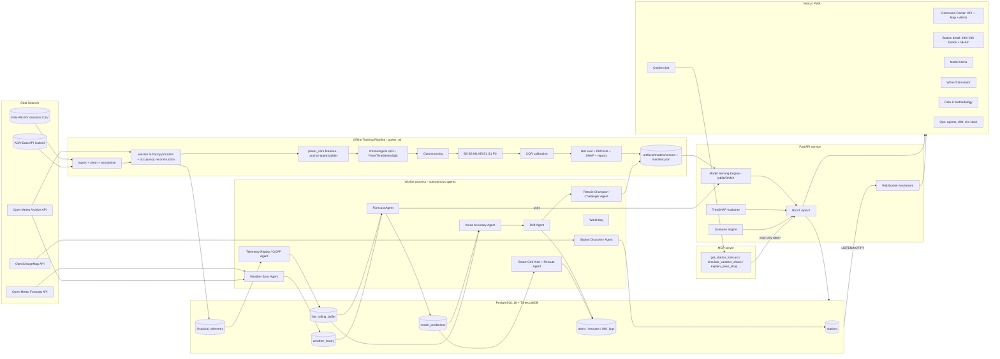
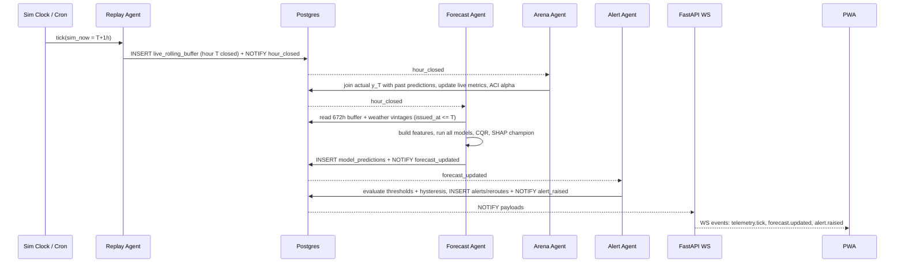

# P.O.W.E.R. — Deliverable 3
## System Design, File Architecture, Database, API, Agents & MCP Blueprint

Target: **Option A only**, a full-stack production PWA. No Streamlit and no throw-away prototype.

---

## 3.0 Final technology stack (audited)

| Layer | Choice | Why (and what was dropped) |
|---|---|---|
| Monorepo | `pnpm` workspaces (web) + `uv` workspace (Python), one `Makefile`, `docker compose` | One-command reproducibility |
| Shared ML core | **`packages/power_core`** (Python): feature builder, schemas, metrics, conformal | **The same feature code is imported by training, API and worker.** This is the main defence against train/serve skew |
| Data / ML | Python 3.12, pandas 2, numpy, scipy, `holidays`, scikit-learn, xgboost 2.x, lightgbm 4.x, optuna 4.x, shap, statsmodels, PyTorch (training only), onnx + onnxruntime (serving) | Prophet dropped (see Deliverable 2) |
| Experiment tracking | MLflow (local file store `mlruns/`) | Every training run logs params, metrics, data hash and git SHA |
| Backend | FastAPI, Uvicorn, Pydantic v2, SQLAlchemy 2 (async) + asyncpg, Alembic, HTTPX | |
| Workers | Separate `worker` process: APScheduler `AsyncIOScheduler` (single instance) + event loop on Postgres `LISTEN/NOTIFY` | Not inside the API process (F13) |
| Database | **PostgreSQL 16 + TimescaleDB** (hypertables for telemetry/predictions, retention policies) | Redis dropped; SQLite dropped for the PWA (it's single-writer, and test parity matters) |
| Real-time push | WebSocket `/ws/stream` (FastAPI), fed by `LISTEN/NOTIFY` | SSE is a fallback for restrictive networks |
| Optional OCPP | `ocpp` Python library (OCPP 1.6J / 2.0.1 CSMS endpoint) | The replay agent can act as simulated charge points over real OCPP WebSockets |
| Frontend | **Next.js 15 (App Router) + React 19 + TypeScript**, Tailwind CSS v4, shadcn/ui, TanStack Query v5, Zustand | |
| Charts | Recharts (range `Area` for bands, `ReferenceLine` for capacity) | |
| Map | **MapLibre GL JS** via `react-map-gl/maplibre` + **deck.gl** (`ScatterplotLayer` halos, `ArcLayer` reroutes) with a free vector-tile basemap | Mapbox dropped (token + billing) |
| PWA | **Serwist** (`@serwist/next`) service worker, web app manifest, offline snapshot cache, **Web Push (VAPID)** for CRITICAL alerts | `next-pwa` is unmaintained |
| AI copilot | **MCP server** (`mcp` Python SDK, FastMCP) + in-app chat using the Anthropic Messages API with tool use (model `claude-sonnet-5-5`) | |
| Testing | pytest + hypothesis (leakage/property tests), testcontainers-postgres, Vitest + React Testing Library, Playwright e2e | |
| Observability | structlog JSON logs, Prometheus `/metrics`, optional Grafana dashboard JSON | |
| CI | GitHub Actions: lint (ruff, mypy, eslint, tsc), tests, docker build, Lighthouse PWA audit | |

---

## 3.1 High-level architecture



**Real-time sequence (one tick):**



---

## 3.2 Directory & file tree

```
P.O.W.E.R/
├── README.md
├── LICENSE                               # MIT (code); datasets keep their own licences
├── Makefile                              # one-command targets (see README)
├── docker-compose.yml                    # db, api, worker, web, mcp, (mlflow)
├── docker-compose.override.yml           # dev mounts / hot reload
├── .env.example
├── pyproject.toml                        # uv workspace root
├── uv.lock                               # pinned Python deps (reproducibility)
├── pnpm-workspace.yaml
├── pnpm-lock.yaml
├── .github/
│   └── workflows/
│       ├── ci.yml                        # lint + typecheck + tests (py + ts)
│       ├── e2e.yml                       # Playwright against compose stack
│       └── docker.yml                    # build & push images on tag
├── configs/
│   ├── data.yaml                         # dataset paths, window (pre-COVID), timezone, site grouping rules
│   ├── features.yaml                     # feature list + anchor class + model membership
│   ├── models.yaml                       # model zoo, Optuna spaces, seeds
│   ├── thresholds.yaml                   # DF, alert thresholds, hysteresis, reroute radius
│   └── agents.yaml                       # cron schedules, sim speed, retrain gates
├── data/                                 # git-ignored except manifests
│   ├── manifest.json                     # source URLs, download date, sha256, row counts
│   ├── raw/                              # palo_alto_sessions.csv, acn_caltech_sessions.json
│   ├── interim/                          # cleaned sessions (anonymised)
│   ├── processed/                        # hourly_panel.parquet, splits/{train,val,test}.parquet
│   └── external/                         # weather_archive.parquet, ocm_stations.json
├── packages/
│   └── power_core/                       # SHARED by training, API, worker, MCP
│       ├── pyproject.toml
│       └── src/power_core/
│           ├── __init__.py
│           ├── config.py                 # pydantic-settings; loads configs/*.yaml
│           ├── timeutils.py              # UTC <-> local, DST-safe hourly grid
│           ├── schemas.py                # pydantic models shared with API (Forecast, Alert, ...)
│           ├── features/
│           │   ├── registry.py           # FeatureSpec(name, anchor={TGT,ORG,STA}, fn, models)
│           │   ├── calendar.py
│           │   ├── lags.py               # target-anchored seasonal lags (lag >= h enforced)
│           │   ├── rolling.py            # origin-anchored windows
│           │   ├── occupancy.py
│           │   ├── weather.py            # hinge features, forecast-error augmentation
│           │   ├── static.py
│           │   └── builder.py            # build_training_frame(panel, H) / build_serving_frame(buffer, T)
│           ├── splits.py                 # chronological_split, PanelTimeSeriesSplit(gap, embargo)
│           ├── metrics.py                # MAE RMSE WAPE MASE R2 MAPE+ pinball PICP MPIW Winkler
│           ├── stats.py                  # Diebold-Mariano (HAC), bootstrap CIs
│           ├── conformal.py              # CQR (Mondrian), split-conformal, ACI online updater
│           ├── drift.py                  # seasonal (hour-of-week standardised) PSI, Page-Hinkley
│           ├── grid.py                   # load ratio, alert levels, hysteresis, reroute planner
│           └── geo.py                    # haversine, kNN station neighbours
├── ml/                                   # offline pipeline (power_ml)
│   ├── pyproject.toml
│   ├── src/power_ml/
│   │   ├── cli.py                        # `power-ml <stage>` entrypoints (Typer)
│   │   ├── ingest/
│   │   │   ├── palo_alto.py              # download + parse + site grouping
│   │   │   ├── acn.py                    # acnportal / REST client (token)
│   │   │   ├── weather_archive.py        # Open-Meteo archive back-fill, batched coords
│   │   │   └── anonymise.py              # drop user ids / zip codes, hash session ids
│   │   ├── resample.py                   # proration + occupancy reconstruction + gap-free grid
│   │   ├── eda.py                        # figures to reports/figures/eda_*
│   │   ├── models/
│   │   │   ├── base.py                   # ForecastModel protocol: fit/predict/predict_interval
│   │   │   ├── baselines.py              # B0-B3
│   │   │   ├── ridge.py                  # M1 (log1p + smearing)
│   │   │   ├── random_forest.py          # M2
│   │   │   ├── xgboost_model.py          # M3
│   │   │   ├── lightgbm_model.py         # M4 (+ quantile heads, monotone constraints)
│   │   │   ├── lstm_seq2seq.py           # M5 (PyTorch) + onnx export
│   │   │   ├── ensemble.py               # E1 (NNLS weights on val)
│   │   │   ├── occupancy.py              # S1
│   │   │   └── prior.py                  # P0 cold-start
│   │   ├── tune.py                       # Optuna studies (sqlite storage in mlruns/optuna.db)
│   │   ├── train.py                      # fit champions on train, early-stop on val
│   │   ├── calibrate.py                  # CQR per horizon bucket on val
│   │   ├── evaluate.py                   # single test-set pass -> reports/metrics_test.json
│   │   ├── ablations.py                  # A1 recursive, A2 L2, A3 no-weather, DF sensitivity
│   │   ├── explain.py                    # global SHAP (beeswarm json + png), dependence plots
│   │   ├── error_analysis.py             # residuals by hour/station/saturation/temp tercile
│   │   ├── stress_test.py                # COVID OOD window evaluation
│   │   └── export.py                     # artifacts/models/<version>/ + manifest.json
│   └── tests/
├── notebooks/                            # narrative only; logic lives in packages
│   ├── 01_eda_and_data_card.ipynb
│   ├── 02_feature_engineering_and_leakage_checks.ipynb
│   ├── 03_model_arena_results.ipynb
│   ├── 04_xai_and_error_analysis.ipynb
│   └── 05_covid_stress_test.ipynb
├── artifacts/                            # git-ignored; produced by `make train`
│   └── models/
│       └── 2026.11.0/
│           ├── manifest.json             # version, git_sha, data_sha256, feature_hash, train/val/test ranges, metrics
│           ├── preprocessor_ridge.joblib
│           ├── ridge.joblib  rf.joblib  xgb.json  lgbm_mean.txt  lgbm_q05.txt  lgbm_q50.txt  lgbm_q95.txt
│           ├── lstm.onnx  ensemble.json  occupancy.txt  prior.txt
│           ├── conformal.json            # Q_B per model per horizon bucket
│           ├── shap_background.parquet
│           └── reference_stats.parquet   # drift reference by hour-of-week
├── reports/
│   ├── metrics_test.json  metrics_by_horizon.csv  dm_tests.csv  ablations.csv
│   ├── figures/                          # all report figures (png + svg)
│   ├── data_card.md  model_card.md
│   └── report/                           # final .docx / .pdf
├── services/
│   ├── api/
│   │   ├── Dockerfile
│   │   ├── pyproject.toml
│   │   ├── alembic.ini
│   │   ├── migrations/                   # Alembic versions (DDL of §3.3)
│   │   └── src/power_api/
│   │       ├── main.py                   # app factory, lifespan (load registry, DB pool, NOTIFY listener)
│   │       ├── deps.py                   # db session, auth (API key / admin token), model registry
│   │       ├── db/
│   │       │   ├── models.py             # SQLAlchemy ORM
│   │       │   └── repositories.py
│   │       ├── serving/
│   │       │   ├── registry.py           # loads artifacts/models/<version>; hot-swap on promotion
│   │       │   ├── engine.py             # run_all_models(features) -> {model: (q05,q50,q95,mean)}
│   │       │   ├── explain.py            # TreeSHAP for champion, cached per (station, origin)
│   │       │   └── scenarios.py          # what-if perturbations + OOD flags + elasticity overlay
│   │       ├── routers/
│   │       │   ├── health.py  stations.py  network.py  forecasts.py  models.py
│   │       │   ├── explain.py  scenarios.py  alerts.py  drift.py  sim.py  push.py
│   │       ├── ws/
│   │       │   ├── hub.py                # connection manager, channel subscriptions
│   │       │   └── listener.py           # asyncpg LISTEN -> hub.broadcast
│   │       └── ocpp/
│   │           └── csms.py               # optional OCPP 1.6J/2.0.1 central system endpoint
│   ├── worker/
│   │   ├── Dockerfile
│   │   └── src/power_worker/
│   │       ├── main.py                   # scheduler + event loop + leader lock (pg_advisory_lock)
│   │       ├── base.py                   # Agent ABC: run(), idempotency key, agent_runs logging
│   │       └── agents/
│   │           ├── replay.py  weather_sync.py  forecast.py  arena.py  drift.py
│   │           ├── alerts.py  retrain.py  discovery.py  watchdog.py
│   └── mcp/
│       ├── Dockerfile
│       └── src/power_mcp/
│           ├── server.py                 # FastMCP app: tools, resources, prompts
│           ├── client.py                 # typed HTTPX client to power_api (read-only token)
│           └── guards.py                 # input validation, rate limit, no-PII guarantee
├── apps/
│   └── web/
│       ├── Dockerfile
│       ├── next.config.ts                # Serwist plugin, security headers
│       ├── package.json
│       ├── public/
│       │   ├── manifest.webmanifest
│       │   └── icons/                    # 192/512 maskable
│       ├── src/
│       │   ├── app/
│       │   │   ├── layout.tsx            # shell, theme, QueryClient, WS provider
│       │   │   ├── page.tsx              # Command Center
│       │   │   ├── stations/[id]/page.tsx
│       │   │   ├── arena/page.tsx
│       │   │   ├── simulator/page.tsx
│       │   │   ├── explain/page.tsx      # global SHAP
│       │   │   ├── data/page.tsx         # data card, EDA, methodology (rubric 15+20 marks on screen)
│       │   │   ├── ops/page.tsx          # agents, drift, sim clock controls
│       │   │   ├── api/copilot/route.ts  # server-side Claude call + tool loop
│       │   │   ├── sw.ts                 # Serwist service worker (cache + push)
│       │   │   └── offline/page.tsx
│       │   ├── components/
│       │   │   ├── kpi/KpiRibbon.tsx  RiskBadge.tsx
│       │   │   ├── charts/ForecastBandChart.tsx  HorizonErrorChart.tsx  ResidualHeatmap.tsx
│       │   │   ├── map/StationMap.tsx  StationHalos.ts  RerouteArcs.ts  TimeScrubber.tsx  MapLegend.tsx
│       │   │   ├── arena/LeaderboardTable.tsx  LiveMetricsTable.tsx  DmMatrix.tsx  ModelToggle.tsx
│       │   │   ├── xai/ShapWaterfall.tsx  ShapBeeswarm.tsx  ShapNarrative.tsx
│       │   │   ├── simulator/ScenarioControls.tsx  ScenarioDiffChart.tsx  OodBadge.tsx
│       │   │   ├── alerts/AlertFeed.tsx  AlertDrawer.tsx
│       │   │   ├── ops/AgentStatusGrid.tsx  SimClockControls.tsx  DriftPanel.tsx
│       │   │   └── copilot/CopilotPanel.tsx
│       │   ├── lib/
│       │   │   ├── api.ts                # typed fetchers (generated from OpenAPI)
│       │   │   ├── ws.ts                 # reconnecting WS client, backoff, resubscribe
│       │   │   ├── push.ts               # subscribe to Web Push
│       │   │   └── format.ts
│       │   ├── stores/simStore.ts  mapStore.ts
│       │   └── types/openapi.d.ts        # `pnpm gen:api` via openapi-typescript
│       └── tests/                        # vitest + playwright
├── scripts/
│   ├── download_data.sh                  # fetch + checksum
│   ├── seed_db.py                        # load stations + historical_telemetry
│   └── demo_reset.py                     # reset sim clock to viva start point
└── docs/
    ├── 01_audit_and_refinement.md
    ├── 02_system_blueprint.md
    ├── architecture.md  api.md  agents.md  mcp.md  viva_demo_script.md
    └── proposal.md                        # faculty proposal (Final Recommendation)
```

---

## 3.3 Database schema (PostgreSQL 16 + TimescaleDB DDL)

```sql
-- 0. Extensions -------------------------------------------------------------
CREATE EXTENSION IF NOT EXISTS timescaledb;

-- 1. Stations ---------------------------------------------------------------
CREATE TABLE stations (
    station_id        TEXT PRIMARY KEY,                 -- e.g. 'PA_HAMILTON'
    name              TEXT NOT NULL,
    source            TEXT NOT NULL CHECK (source IN ('palo_alto','acn','openchargemap')),
    latitude          DOUBLE PRECISION NOT NULL CHECK (latitude  BETWEEN -90  AND 90),
    longitude         DOUBLE PRECISION NOT NULL CHECK (longitude BETWEEN -180 AND 180),
    total_ports       INTEGER NOT NULL CHECK (total_ports > 0),
    rated_kw_total    DOUBLE PRECISION NOT NULL CHECK (rated_kw_total > 0),   -- Σ port kW
    diversity_factor  DOUBLE PRECISION NOT NULL DEFAULT 0.70 CHECK (diversity_factor BETWEEN 0.1 AND 1.0),
    transformer_kw    DOUBLE PRECISION GENERATED ALWAYS AS (rated_kw_total * diversity_factor) STORED, -- SYNTHETIC
    poi_category      TEXT NOT NULL DEFAULT 'unknown',
    timezone          TEXT NOT NULL DEFAULT 'America/Los_Angeles',
    first_seen        TIMESTAMPTZ,
    is_modeled        BOOLEAN NOT NULL DEFAULT TRUE,     -- FALSE = context pin (cold-start prior only)
    created_at        TIMESTAMPTZ NOT NULL DEFAULT now(),
    updated_at        TIMESTAMPTZ NOT NULL DEFAULT now()
);

CREATE TABLE station_ports (
    port_id           TEXT PRIMARY KEY,                  -- original EVSE id (hashed if needed)
    station_id        TEXT NOT NULL REFERENCES stations(station_id) ON DELETE CASCADE,
    connector_type    TEXT,                              -- J1772, CCS1, NACS ...
    port_kw           DOUBLE PRECISION NOT NULL CHECK (port_kw > 0)
);

-- 2. Anonymised historical sessions (source of truth for resampling) ---------
CREATE TABLE charging_sessions (
    session_hash      TEXT PRIMARY KEY,                  -- sha256(source_id + salt); no user/MAC/zip
    station_id        TEXT NOT NULL REFERENCES stations(station_id),
    port_id           TEXT REFERENCES station_ports(port_id),
    connect_time      TIMESTAMPTZ NOT NULL,
    charge_end_time   TIMESTAMPTZ,                       -- doneChargingTime or start + charging time
    disconnect_time   TIMESTAMPTZ NOT NULL,
    energy_kwh        DOUBLE PRECISION NOT NULL CHECK (energy_kwh >= 0),
    quality_flags     INTEGER NOT NULL DEFAULT 0,        -- bitmask: 1=capped power, 2=imputed end, 4=dup
    CHECK (disconnect_time > connect_time)
);
CREATE INDEX ON charging_sessions (station_id, connect_time);

-- 3. Hourly historical panel (training + replay source) -----------------------
CREATE TABLE historical_telemetry (
    ts                TIMESTAMPTZ NOT NULL,              -- hour start, UTC
    station_id        TEXT NOT NULL REFERENCES stations(station_id),
    energy_kwh        DOUBLE PRECISION NOT NULL CHECK (energy_kwh >= 0),
    occ_ratio         DOUBLE PRECISION NOT NULL CHECK (occ_ratio BETWEEN 0 AND 1),
    idle_ratio        DOUBLE PRECISION CHECK (idle_ratio BETWEEN 0 AND 1),
    active_sessions   SMALLINT NOT NULL DEFAULT 0,
    occupied_ports    SMALLINT NOT NULL DEFAULT 0,
    arrivals          SMALLINT NOT NULL DEFAULT 0,
    is_saturated      BOOLEAN NOT NULL DEFAULT FALSE,
    split             TEXT NOT NULL CHECK (split IN ('train','val','test','ood')),
    PRIMARY KEY (station_id, ts)
);
SELECT create_hypertable('historical_telemetry', 'ts', chunk_time_interval => INTERVAL '90 days');

-- 4. Live rolling buffer (raw actuals only; features computed on read) --------
CREATE TABLE live_rolling_buffer (
    ts                TIMESTAMPTZ NOT NULL,              -- hour start in *sim/live* time, UTC
    station_id        TEXT NOT NULL REFERENCES stations(station_id),
    energy_kwh        DOUBLE PRECISION NOT NULL CHECK (energy_kwh >= 0),
    occ_ratio         DOUBLE PRECISION NOT NULL,
    idle_ratio        DOUBLE PRECISION,
    active_sessions   SMALLINT NOT NULL,
    occupied_ports    SMALLINT NOT NULL,
    arrivals          SMALLINT NOT NULL,
    is_saturated      BOOLEAN NOT NULL,
    is_imputed        BOOLEAN NOT NULL DEFAULT FALSE,    -- missing tick filled by seasonal profile
    source_ts         TIMESTAMPTZ,                       -- original historical ts (REPLAY/LIVE_SHADOW)
    ingested_at       TIMESTAMPTZ NOT NULL DEFAULT now(),
    PRIMARY KEY (station_id, ts)
);
SELECT create_hypertable('live_rolling_buffer', 'ts', chunk_time_interval => INTERVAL '7 days');
SELECT add_retention_policy('live_rolling_buffer', INTERVAL '60 days');   -- ≥ 672 h needed

-- 5. Weather with vintages (prevents look-ahead) ------------------------------
CREATE TABLE weather_hourly (
    station_id        TEXT NOT NULL REFERENCES stations(station_id),
    valid_time        TIMESTAMPTZ NOT NULL,              -- hour the value describes
    issued_at         TIMESTAMPTZ NOT NULL,              -- when the forecast was fetched (archive: = valid_time)
    source            TEXT NOT NULL CHECK (source IN ('archive','forecast','climatology')),
    temperature_2m_c  DOUBLE PRECISION,
    precipitation_mm  DOUBLE PRECISION CHECK (precipitation_mm >= 0),
    relative_humidity DOUBLE PRECISION,                  -- stored for ablation only
    PRIMARY KEY (station_id, valid_time, issued_at)
);
SELECT create_hypertable('weather_hourly', 'valid_time', chunk_time_interval => INTERVAL '30 days');
-- Serving query rule: latest issued_at <= forecast origin T for each valid_time.

-- 6. Model registry -------------------------------------------------------------
CREATE TABLE model_registry (
    model_version     TEXT NOT NULL,                     -- '2026.11.0'
    model_name        TEXT NOT NULL,                     -- 'B1','ridge','rf','xgb','lgbm','lstm','ensemble','occupancy','prior'
    artifact_uri      TEXT NOT NULL,
    feature_hash      TEXT NOT NULL,
    train_range       TSTZRANGE NOT NULL,
    val_range         TSTZRANGE NOT NULL,
    test_range        TSTZRANGE NOT NULL,
    metrics_test      JSONB NOT NULL,                    -- {"wape":..,"mase":..,"picp":..}
    status            TEXT NOT NULL CHECK (status IN ('champion','challenger','archived','baseline')),
    created_at        TIMESTAMPTZ NOT NULL DEFAULT now(),
    PRIMARY KEY (model_version, model_name)
);

-- 7. Predictions (one row per station x origin x horizon x model) -----------
CREATE TABLE model_predictions (
    forecast_origin   TIMESTAMPTZ NOT NULL,              -- T
    target_time       TIMESTAMPTZ NOT NULL,              -- T + h
    horizon_h         SMALLINT NOT NULL CHECK (horizon_h BETWEEN 1 AND 24),
    station_id        TEXT NOT NULL REFERENCES stations(station_id),
    model_version     TEXT NOT NULL,
    model_name        TEXT NOT NULL,
    y_mean            DOUBLE PRECISION NOT NULL,
    q05               DOUBLE PRECISION,
    q50               DOUBLE PRECISION,
    q95               DOUBLE PRECISION,
    occ_ratio_pred    DOUBLE PRECISION,
    load_ratio_q95    DOUBLE PRECISION,                  -- q95 / transformer_kw
    is_degraded       BOOLEAN NOT NULL DEFAULT FALSE,    -- fallback used (imputed inputs / stale weather)
    latency_ms        REAL,
    created_at        TIMESTAMPTZ NOT NULL DEFAULT now(),
    PRIMARY KEY (station_id, model_name, forecast_origin, horizon_h),
    FOREIGN KEY (model_version, model_name) REFERENCES model_registry(model_version, model_name),
    CHECK (q05 IS NULL OR (q05 <= q50 AND q50 <= q95))
);
SELECT create_hypertable('model_predictions', 'forecast_origin', chunk_time_interval => INTERVAL '7 days');
CREATE INDEX ON model_predictions (station_id, target_time);

-- 8. Local explanations (champion only) -------------------------------------
CREATE TABLE prediction_explanations (
    station_id        TEXT NOT NULL,
    forecast_origin   TIMESTAMPTZ NOT NULL,
    horizon_h         SMALLINT NOT NULL,
    model_name        TEXT NOT NULL,
    base_value        DOUBLE PRECISION NOT NULL,
    contributions     JSONB NOT NULL,                    -- [{"feature":"lag_24h","value":31.2,"shap":4.2}, ...]
    PRIMARY KEY (station_id, forecast_origin, horizon_h, model_name)
);

-- 9. Live arena metrics ------------------------------------------------------
CREATE TABLE live_metrics (
    window_end        TIMESTAMPTZ NOT NULL,
    model_name        TEXT NOT NULL,
    horizon_bucket    TEXT NOT NULL CHECK (horizon_bucket IN ('1-3','4-12','13-24','all')),
    station_id        TEXT NOT NULL DEFAULT '__network__',
    n                 INTEGER NOT NULL,
    mae DOUBLE PRECISION, rmse DOUBLE PRECISION, wape DOUBLE PRECISION,
    picp DOUBLE PRECISION, mpiw DOUBLE PRECISION, aci_alpha DOUBLE PRECISION,
    PRIMARY KEY (window_end, model_name, horizon_bucket, station_id)
);

-- 10. Drift logs ---------------------------------------------------------------
CREATE TABLE drift_logs (
    id                BIGSERIAL PRIMARY KEY,
    detected_at       TIMESTAMPTZ NOT NULL DEFAULT now(),
    station_id        TEXT,                               -- NULL = network-wide
    kind              TEXT NOT NULL CHECK (kind IN ('feature_psi','residual_page_hinkley','wape_ratio','coverage')),
    feature           TEXT,
    statistic         DOUBLE PRECISION NOT NULL,
    threshold         DOUBLE PRECISION NOT NULL,
    is_drift          BOOLEAN NOT NULL,
    action            TEXT CHECK (action IN ('none','flag','recommend_retrain','retrain_started')),
    details           JSONB
);

-- 11. Alerts (with hysteresis state) and reroute recommendations ------------
CREATE TABLE alerts (
    alert_id          BIGSERIAL PRIMARY KEY,
    station_id        TEXT NOT NULL REFERENCES stations(station_id),
    level             TEXT NOT NULL CHECK (level IN ('WARNING','CRITICAL')),
    target_time       TIMESTAMPTZ NOT NULL,
    forecast_origin   TIMESTAMPTZ NOT NULL,
    load_ratio_q95    DOUBLE PRECISION NOT NULL,
    message           TEXT NOT NULL,
    status            TEXT NOT NULL DEFAULT 'open' CHECK (status IN ('open','acknowledged','resolved')),
    dedupe_key        TEXT NOT NULL,                      -- station|target_time|level
    raised_at         TIMESTAMPTZ NOT NULL DEFAULT now(),
    resolved_at       TIMESTAMPTZ,
    UNIQUE (dedupe_key)
);

CREATE TABLE reroute_recommendations (
    id                BIGSERIAL PRIMARY KEY,
    alert_id          BIGINT NOT NULL REFERENCES alerts(alert_id) ON DELETE CASCADE,
    from_station      TEXT NOT NULL REFERENCES stations(station_id),
    to_station        TEXT NOT NULL REFERENCES stations(station_id),
    distance_km       DOUBLE PRECISION NOT NULL,
    shifted_kwh       DOUBLE PRECISION NOT NULL CHECK (shifted_kwh > 0),
    to_headroom_kwh   DOUBLE PRECISION NOT NULL,
    created_at        TIMESTAMPTZ NOT NULL DEFAULT now()
);

-- 12. Scenario runs (what-if; never mutate live state) ----------------------
CREATE TABLE scenario_runs (
    scenario_id       UUID PRIMARY KEY DEFAULT gen_random_uuid(),
    requested_by      TEXT NOT NULL DEFAULT 'ui',         -- 'ui' | 'mcp' | 'copilot'
    params            JSONB NOT NULL,
    result_summary    JSONB NOT NULL,
    ood_flags         JSONB NOT NULL DEFAULT '[]',
    created_at        TIMESTAMPTZ NOT NULL DEFAULT now()
);

-- 13. Simulation clock (singleton) + agent heartbeats -----------------------
CREATE TABLE sim_state (
    id                SMALLINT PRIMARY KEY DEFAULT 1 CHECK (id = 1),
    mode              TEXT NOT NULL CHECK (mode IN ('REPLAY','LIVE_SHADOW','LIVE')),
    sim_now           TIMESTAMPTZ NOT NULL,
    speed_ticks_per_min REAL NOT NULL DEFAULT 1.0,
    paused            BOOLEAN NOT NULL DEFAULT TRUE,
    week_offset_hours INTEGER NOT NULL DEFAULT 0,         -- LIVE_SHADOW restamp Δ (multiple of 168)
    updated_at        TIMESTAMPTZ NOT NULL DEFAULT now()
);

CREATE TABLE agent_runs (
    id                BIGSERIAL PRIMARY KEY,
    agent             TEXT NOT NULL,
    idempotency_key   TEXT NOT NULL,                      -- e.g. 'forecast:2019-06-03T17:00Z'
    started_at        TIMESTAMPTZ NOT NULL DEFAULT now(),
    finished_at       TIMESTAMPTZ,
    status            TEXT NOT NULL CHECK (status IN ('running','ok','error','skipped')),
    details           JSONB,
    UNIQUE (agent, idempotency_key)
);

CREATE TABLE push_subscriptions (
    endpoint          TEXT PRIMARY KEY,
    p256dh            TEXT NOT NULL,
    auth              TEXT NOT NULL,
    min_level         TEXT NOT NULL DEFAULT 'CRITICAL',
    created_at        TIMESTAMPTZ NOT NULL DEFAULT now()
);

-- NOTIFY channels: hour_closed, forecast_updated, alert_raised, drift_detected, sim_clock
```

---

## 3.4 REST & WebSocket API specification

Base URL `/api/v1`. JSON, ISO-8601 UTC timestamps, kWh units. OpenAPI is auto-generated at `/docs`, and frontend types are generated from it. Auth: public read endpoints are rate-limited. Mutating endpoints (`/sim/*`, `/alerts/*/ack`, retrain) require `Authorization: Bearer <ADMIN_TOKEN>`. The MCP server uses a separate read-only token.

| Method | Path | Purpose |
|---|---|---|
| GET | `/health`, `/ready` | liveness; readiness (DB + model registry loaded) |
| GET | `/stations?modeled=true` | list stations with live status |
| GET | `/stations/{id}` | metadata + current state |
| GET | `/stations/{id}/telemetry?from=&to=` | actuals from buffer/historical |
| GET | `/stations/{id}/forecast?model=champion&horizon=24` | 24-h forecast with intervals |
| GET | `/network/kpis` | KPI ribbon |
| GET | `/network/snapshot?h=1..24&model=champion` | map state for the time scrubber |
| GET | `/models` | registry + test metrics |
| GET | `/models/leaderboard?split=test&horizon=all&metric=wape` | rubric comparison table |
| GET | `/models/live-arena?window=168h` | rolling live metrics per model |
| GET | `/models/dm-tests` | Diebold–Mariano matrix |
| GET | `/explain/global?model=lgbm` | mean abs SHAP + beeswarm sample |
| GET | `/stations/{id}/explain?target_time=&model=lgbm` | local SHAP waterfall |
| POST | `/scenarios/simulate` | what-if (never mutates live state) |
| GET | `/alerts?status=open` | alerts feed |
| POST | `/alerts/{id}/ack` | acknowledge (admin) |
| GET | `/reroutes?active=true` | arcs for the map |
| GET | `/drift?days=7` | drift logs |
| GET | `/sim/state` · POST `/sim/control` · POST `/sim/tick` | sim clock (admin) |
| POST | `/push/subscribe` | Web Push subscription |
| GET | `/datacard` | dataset documentation (counts, ranges, limitations) |

### Key schemas

**GET `/stations/{id}/forecast`** →
```json
{
  "station_id": "PA_HAMILTON",
  "model": "lgbm",
  "model_version": "2026.11.0",
  "forecast_origin": "2019-06-03T17:00:00Z",
  "transformer_kw": 151.2,
  "interval_level": 0.90,
  "is_degraded": false,
  "points": [
    {"target_time": "2019-06-03T18:00:00Z", "h": 1, "y_mean": 41.8, "q05": 30.2, "q50": 41.0, "q95": 55.9,
     "occ_ratio": 0.83, "load_ratio_q95": 0.37, "risk": "NORMAL"}
  ],
  "history": [{"ts": "2019-06-01T18:00:00Z", "energy_kwh": 38.4, "is_imputed": false}]
}
```

**GET `/network/kpis`** →
```json
{
  "as_of": "2019-06-03T17:00:00Z",
  "sim_mode": "REPLAY",
  "current_load_kw": 212.4,
  "next_hour": {"y_mean": 236.0, "lower": 201.5, "upper": 279.8, "interval_level": 0.90, "method": "aggregate_conformal"},
  "port_occupancy_pct": 71.3,
  "idle_port_pct": 18.9,
  "risk_status": "WARNING",
  "stations_by_risk": {"NORMAL": 7, "WARNING": 2, "CRITICAL": 1},
  "live_wape_24h": {"lgbm": 0.212, "B1": 0.341}
}
```

**GET `/network/snapshot?h=6`** →
```json
{
  "target_time": "2019-06-03T23:00:00Z",
  "stations": [
    {"station_id": "PA_HAMILTON", "lat": 37.4446, "lon": -122.1608, "q50": 22.1, "q95": 31.0,
     "load_ratio_q50": 0.15, "occ_ratio": 0.41, "risk": "NORMAL", "is_modeled": true}
  ],
  "reroutes": [{"from": "PA_BRYANT", "to": "PA_WEBSTER", "shifted_kwh": 12.5, "distance_km": 0.8}]
}
```

**GET `/models/leaderboard`** →
```json
{
  "split": "test", "test_range": ["2019-09-15T00:00:00Z", "2020-02-29T23:00:00Z"],
  "rows": [
    {"model": "lgbm", "wape": null, "mase": null, "mae": null, "rmse": null, "r2": null,
     "mape_filtered": null, "peak_mae": null, "picp": null, "mpiw": null, "winkler": null,
     "train_time_s": null, "p50_latency_ms": null}
  ],
  "note": "values filled from reports/metrics_test.json; never hard-coded"
}
```

**POST `/scenarios/simulate`** — request:
```json
{
  "station_ids": ["PA_HAMILTON"],
  "origin": "latest",
  "horizon": 24,
  "model": "lgbm",
  "shocks": {
    "temperature_delta_c": 10,
    "precipitation_mm": null,
    "force_holiday": false,
    "tariff_change_pct": null,
    "demand_multiplier": 1.0
  }
}
```
Response:
```json
{
  "scenario_id": "4f1c…",
  "baseline": [{"target_time": "…", "q05": 0, "q50": 0, "q95": 0}],
  "scenario": [{"target_time": "…", "q05": 0, "q50": 0, "q95": 0}],
  "delta_peak_kwh": 0,
  "new_alerts": [{"station_id": "PA_HAMILTON", "target_time": "…", "level": "CRITICAL"}],
  "ood_flags": [{"feature": "temperature_2m_c", "value": 41.3, "train_p99": 34.8,
                 "message": "Outside training range — tree models plateau; treat as indicative"}],
  "assumptions": ["tariff elasticity overlay not applied"]
}
```

**GET `/stations/{id}/explain`** →
```json
{
  "station_id": "PA_HAMILTON", "target_time": "2019-06-03T18:00:00Z", "model": "lgbm",
  "base_value": 18.2, "prediction": 43.0,
  "contributions": [
    {"feature": "hour_cos", "display": "18:00 evening rush", "value": -0.71, "shap": 14.5},
    {"feature": "lag_24h", "display": "Yesterday 18:00 load", "value": 39.4, "shap": 4.2}
  ],
  "narrative": "Base 18.2 kWh + 14.5 evening rush + 6.1 heat + 4.2 yesterday's 18:00 = 43.0 kWh"
}
```
(For Tweedie models, SHAP values are computed on the raw-score / log scale. The waterfall shows log-scale contributions, and the narrative converts the total exactly with `exp(·)`. The quantile-head waterfall is additive in kWh. The UI states which one it is showing.)

**POST `/sim/control`** (admin) → `{"action": "play|pause|step|reset|set_speed|set_mode", "speed_ticks_per_min": 6, "mode": "REPLAY", "reset_to": "2019-09-16T00:00:00Z"}`

### WebSocket `/ws/stream`
Client → server: `{"op": "subscribe", "channels": ["telemetry", "forecast", "alerts", "drift", "sim"], "station_ids": ["*"]}`

Server → client envelope:
```json
{"channel": "forecast", "event": "forecast.updated", "ts": "2019-06-03T17:00:05Z",
 "data": {"station_id": "PA_HAMILTON", "forecast_origin": "2019-06-03T17:00:00Z", "model": "lgbm"}}
```
Events: `telemetry.tick`, `forecast.updated` (a thin event; the client refetches through TanStack Query invalidation), `alert.raised`, `alert.resolved`, `reroute.updated`, `drift.detected`, `sim.clock`, `agent.status`. Heartbeat `ping` every 20 s. The client reconnects with exponential backoff and resubscribes.

---

## 3.5 Autonomous background agents (worker process)

These are **deterministic, event-driven workers**, not LLM agents. The LLM is used only in the copilot (§3.6). Each agent subclasses `Agent` with `run(ctx)`, writes an `agent_runs` row with an **idempotency key** (re-running a tick is a no-op), and publishes via `NOTIFY`. A `pg_advisory_lock` makes sure only one worker is leader.

| # | Agent | Trigger | Inputs → Outputs | Failure handling |
|---|---|---|---|---|
| A1 | **Telemetry Replay / OCPP Agent** | `sim.tick` (REPLAY / LIVE_SHADOW) or hourly cron (LIVE) | `historical_telemetry[split='test']` at `sim_now` (restamped by `week_offset_hours` in LIVE_SHADOW) → `live_rolling_buffer` row per station + `NOTIFY hour_closed`. Optional: emits OCPP `TransactionEvent` / `MeterValues` over WebSocket to `/ocpp/{cp}`, and the CSMS aggregates them into the hour | Missing source hour → seasonal imputation, `is_imputed=true` |
| A2 | **Weather Sync Agent** | cron `:55` hourly + on start-up | Open-Meteo Forecast API, **one batched call for all station coordinates** (`hourly=temperature_2m,precipitation`, `forecast_days=2`) → `weather_hourly(source='forecast', issued_at=now)`. In REPLAY mode it reads the archive | HTTP retry with jitter (3×). Stale > 6 h → carry forward last vintage; > 24 h → climatology, `is_degraded` |
| A3 | **Forecast Agent** | `hour_closed` | 672 h buffer + weather vintages (`issued_at ≤ T`) → `power_core.features.build_serving_frame` → all arena models → CQR → `model_predictions` (24 h × models × stations) + champion SHAP → `NOTIFY forecast_updated` | Model failure isolated per model. > 6 imputed hours → seasonal-naive fallback + `is_degraded` |
| A4 | **Arena Accuracy Agent** | `hour_closed` | New actual `y_T` joined with every prediction whose `target_time = T` → `live_metrics` (rolling 24 h / 168 h) + **ACI** α update per model and bucket | — |
| A5 | **Drift Detection Agent** | hourly after A4, plus a daily deep check | Hour-of-week-standardised PSI vs `reference_stats.parquet`; Page-Hinkley on standardised residuals; WAPE ratio vs validation WAPE; coverage gap → `drift_logs`, `NOTIFY drift_detected`, `action='recommend_retrain'` when ≥ 2 signals persist 24 h | — |
| A6 | **Smart-Grid Alert & Reroute Agent** | `forecast_updated` | `load_ratio_q95 = q95 / transformer_kw`. **Hysteresis:** raise CRITICAL if ≥ 0.85 (WARNING ≥ 0.70); resolve when < 0.80 (< 0.65) for 2 consecutive origins. Then runs the reroute planner (below) → `alerts`, `reroute_recommendations`, Web Push for CRITICAL | `dedupe_key` prevents duplicates |
| A7 | **Retrain (Champion–Challenger) Agent** | weekly cron or A5 recommendation (+ admin approval in UI) | Sliding window (last 365 days of buffer + history) retrains **LightGBM only** with frozen hyper-parameters → recalibrates CQR on the last 14 days → shadow-scores 7 days. **Promotion gate:** challenger WAPE ≤ 0.98 × champion **and** PICP ∈ [0.87, 0.93] **and** no station worse by > 10% → registry `status='champion'`, API hot-swaps | Gate fails → archived, logged |
| A8 | **Station Discovery Agent** | daily | OpenChargeMap (`/v3/poi`, bounding box, API key) → upsert `stations(source='openchargemap', is_modeled=false)` → cold-start prior forecasts (grey pins) | Never affects arena metrics |
| A9 | **Watchdog** | every 5 min | Checks agent heartbeats, buffer freshness and weather staleness → `agent.status` WS events, ops page | Restarts stuck jobs |

**Reroute planner (in `power_core.grid`):**
```
for each CRITICAL station s at target t:
    E = q95_s(t) − θ·C_s                         # excess kWh, θ = 0.85
    D = β·E                                      # divertible share, β = 0.30 (drivers willing to move; assumption)
    candidates j: haversine(s, j) ≤ r (3 km), risk_j(t) = NORMAL
    H_j = θ_safe·C_j − q50_j(t) − already_assigned_j   # θ_safe = 0.70
    sort candidates by score = H_j / (1 + distance_km)
    greedily assign min(D_remaining, H_j) until D = 0
```
Allocation uses forecast headroom including already-assigned load, which prevents cascading overloads. Arcs are drawn with a deck.gl `ArcLayer` whose width scales with the kWh shifted.

---

## 3.6 MCP server & AI copilot

**Purpose.** Natural-language grid querying ("Which station is at risk tonight and why?") without giving an LLM database access. The MCP server is a **thin, read-only adapter over the REST API**, so it shares auth, validation and numbers with the UI.

**Server:** `services/mcp/src/power_mcp/server.py` (FastMCP). Transports: **stdio** (Claude Desktop / Claude Code) and **streamable HTTP** at `:8765/mcp` (web copilot / remote clients).

| Tool | Input schema | Returns |
|---|---|---|
| `list_stations` | `{risk?: "NORMAL"\|"WARNING"\|"CRITICAL"}` | id, name, ports, current risk |
| `get_network_status` | `{}` | KPI ribbon JSON |
| `get_station_forecast` | `{station_id: str, horizon_hours: int=24 (1..24), model: str="champion"}` | 24 points with q05/q50/q95 + risk |
| `explain_peak_shap` | `{station_id: str, target_time?: datetime (default: argmax q50 in next 24 h), top_k: int=6}` | base value, top contributions, narrative |
| `simulate_weather_shock` | `{station_ids: [str] \| ["*"], temperature_delta_c: float (−15..15), precipitation_mm?: float (0..50), force_holiday?: bool}` | baseline vs scenario peaks, new alerts, **OOD flags** (stored in `scenario_runs`, live state untouched) |
| `compare_models` | `{metric: "wape"\|"mase"\|"rmse"\|"picp", horizon: "1"\|"6"\|"24"\|"all", source: "test"\|"live"}` | leaderboard rows |
| `get_alerts` | `{status: "open"\|"all"}` | alerts + reroutes |
| `get_drift_report` | `{days: int=7}` | drift summary |

**Resources:** `power://datacard`, `power://models/leaderboard`, `power://stations/{id}`.
**Prompts:** `grid_briefing` (morning operator briefing), `viva_explainer` (explain a forecast to a non-expert).

**Guard-rails** (`guards.py`): read-only token; pydantic validation with bounds; 30 calls/min; responses never contain session hashes or any user-level data; every scenario is tagged `requested_by='mcp'`.

**Claude Desktop / Claude Code config:**
```json
{
  "mcpServers": {
    "power": {
      "command": "uv",
      "args": ["run", "--directory", "services/mcp", "power-mcp", "--transport", "stdio"],
      "env": { "POWER_API_URL": "http://localhost:8000", "POWER_API_TOKEN": "<read-only token>" }
    }
  }
}
```

**In-app copilot** (`apps/web/src/app/api/copilot/route.ts`): a server-side route calls the Anthropic Messages API (`claude-sonnet-5-5`) with tool definitions that mirror the MCP tools. It executes tool calls against the REST API and streams the answer to `CopilotPanel`. The system prompt rule is: *"Only state numbers returned by a tool; cite the tool; if a scenario has OOD flags, say so."* The API key stays server-side (`ANTHROPIC_API_KEY`), and the copilot is disabled when it is absent. The core project never depends on it.

---

## 3.7 Frontend: required screens for a 15/15 prototype

The course's prototype criterion is "runnable … application with **meaningful inputs and outputs**". Each item below is an input → output loop an examiner can try:

| Screen | Inputs | Outputs | Rubric link |
|---|---|---|---|
| **Command Center** | sim play/pause/step, time scrubber +1…+24 h, model toggle | KPI ribbon (load, next-hour p50 + 90% PI, occupancy, idle %, risk), MapLibre map (colour = `load_ratio_q50`, radius ∝ q50, pulsing halo when CRITICAL), reroute arcs, live alert feed | Prototype 15 |
| **Station detail** | station, model, horizon hover | 48 h actual + 24 h forecast, 90% band, transformer line `C_s`, occupancy/idle forecast, **local SHAP waterfall + narrative** | Prototype, XAI 10 |
| **Model Arena** | metric, horizon, split (test/live) | leaderboard with **train time + latency**, error-vs-horizon curve (incl. recursive ablation), DM matrix, PICP/MPIW | Evaluation 20, §10 ensemble rule |
| **What-If Simulator** | temp Δ, rain, holiday, (tariff overlay), stations | baseline vs scenario curves, Δpeak, new alerts, **OOD badges** | Prototype, Insights |
| **Explainability** | model | global SHAP bar + beeswarm, dependence plots (temperature, hour) | XAI 10 |
| **Data & Methodology** | — | data card (sources, exact counts, ranges, limitations), EDA (daily/weekly profiles, idle-time histogram, saturation share), split diagram, leakage-test status | Dataset 15, Report 10 |
| **Ops** | sim mode, speed, reset, approve retrain | agent heartbeats, drift panel, registry/champion, buffer freshness | Real-time credibility |

Colour thresholds (single source of truth in `thresholds.yaml`): **green** `load_ratio_q50 < 0.50`, **amber** 0.50–0.85, **red / pulsing** ≥ 0.85 or open CRITICAL alert.

PWA requirements: installable (manifest + maskable icons), Lighthouse PWA pass, offline fallback page showing the last cached snapshot with its timestamp, Web Push for CRITICAL alerts, responsive for operator tablets, dark/light theme, and accessible colour (risk shown by icon/label as well as colour).

---

## 3.8 Implementation phases

| Phase | Scope | Exit criterion |
|---|---|---|
| P0 | Proposal to faculty; repo scaffold; CI; compose with Postgres | `make up` green; proposal approved |
| P1 | Ingest + clean + anonymise + proration + occupancy + weather back-fill + data card | Exact counts recorded; EDA figures |
| P2 | `power_core.features` + splits + leakage tests | Future-poisoning & split-purity tests pass |
| P3 | Baselines, Ridge, RF, XGB, LGBM (+ quantiles), Optuna | Validation leaderboard |
| P4 | LSTM, ensemble, CQR, ablations, single test pass, DM tests, SHAP, error analysis, COVID stress test | `reports/metrics_test.json` frozen |
| P5 | API + DB + worker agents A1–A6 | Sim tick end-to-end < 2 s for all stations × models |
| P6 | PWA screens + map + SHAP + simulator + push | Playwright demo script passes |
| P7 | A7–A9, MCP server, copilot | MCP tools callable from Claude Desktop |
| P8 | Report, slides, viva rehearsal | Rubric checklist all green |
