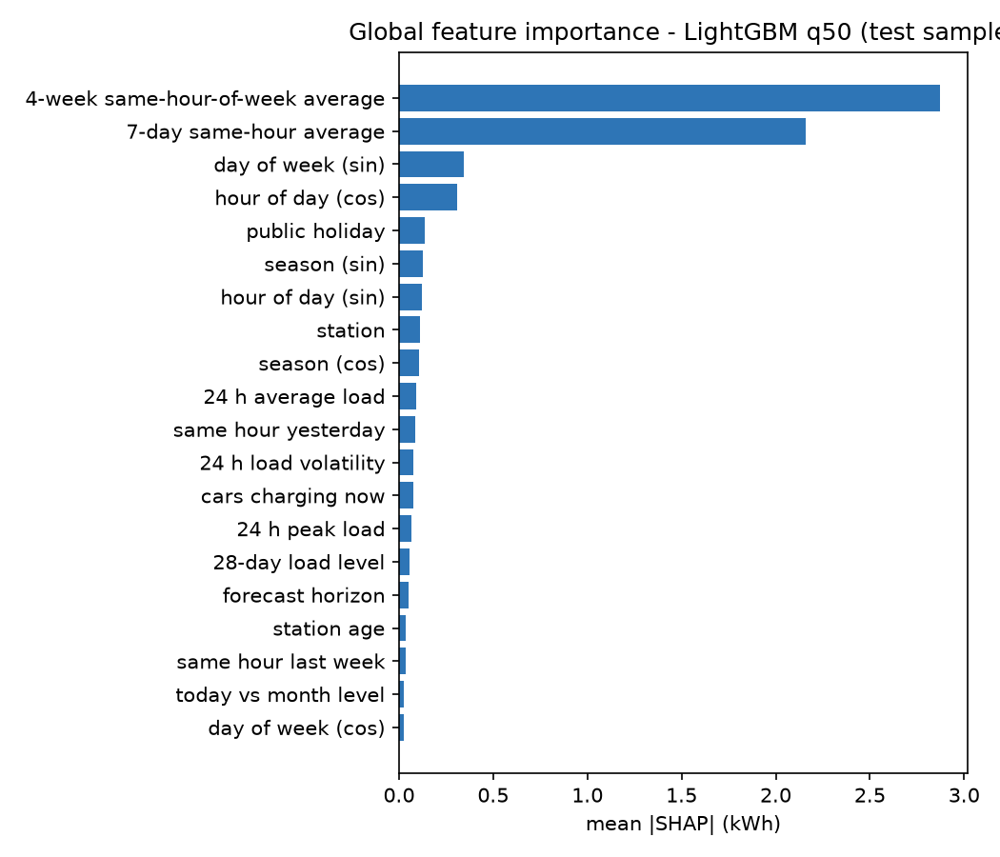
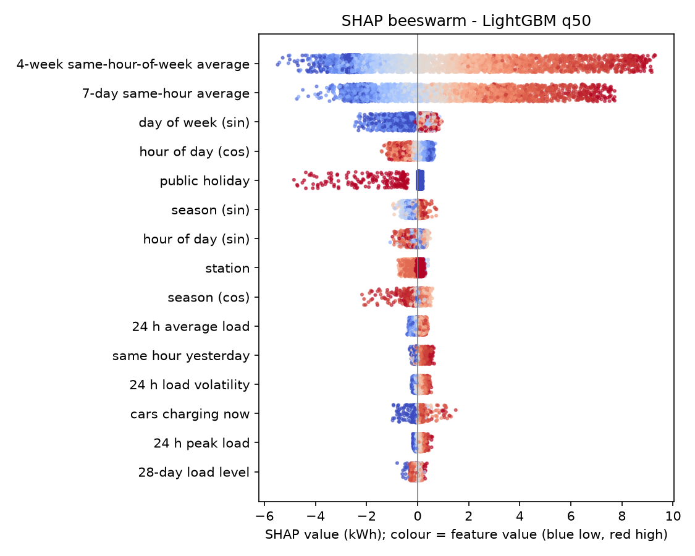
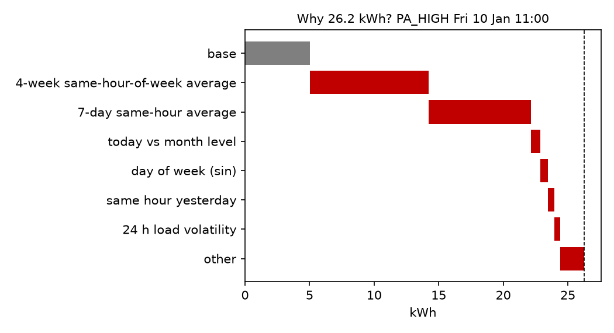
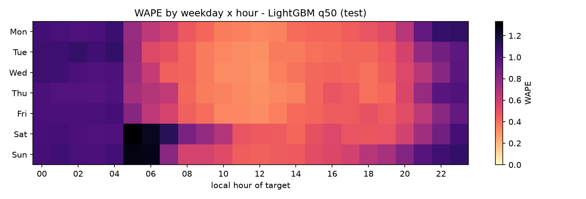
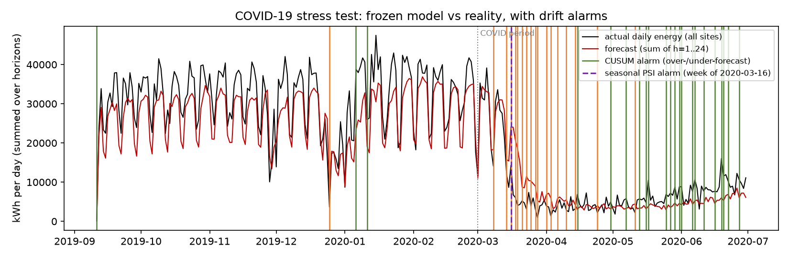

[[TITLE]]

# Abstract

Uncoordinated electric-vehicle (EV) charging concentrates demand into sharp daily peaks that stress local distribution transformers. This project, **P.O.W.E.R. (Predictive Optimization of Wattage for EV Resources)**, builds an end-to-end, real-time machine-learning system that forecasts hourly charging-site energy demand (kWh) 1 to 24 hours ahead, with calibrated 90% prediction intervals and a transformer-risk status. 259,415 charging sessions from the City of Palo Alto (primary) and 27,788 from Caltech ACN-Data (secondary) are converted into a gap-free hourly panel by prorating delivered energy over each session's charging window, and merged with Open-Meteo weather. Following the course guidance for Project #41, four naive and climatology baselines are compared with Ridge Regression, Random Forest, XGBoost, LightGBM (mean and quantile), a Seq2Seq LSTM and a weighted ensemble, under a strictly chronological, leakage-tested direct multi-horizon protocol with Diebold–Mariano significance tests. The champion, a LightGBM quantile model whose median is used as the point forecast, reaches a test WAPE of **0.468 (MASE 0.85)**, **31.8% lower than the seasonal-naive baseline** and 4.3% lower than the mean LightGBM (both differences significant, Holm-adjusted p < 10⁻⁵). Its conformalized 90% intervals cover **89.3%** of test hours. SHAP shows that recurring weekly and daily patterns dominate and that weather barely matters in this mild climate. Frozen on the COVID-19 period, the models' error doubles, and a CUSUM drift detector raises its first alarm on 8 March 2020, nine days before the regional shelter-in-place order. The models drive a production-style progressive web application (Next.js, FastAPI, PostgreSQL/TimescaleDB, Docker Compose). It is deployed as a **Pune pilot digital twin**: nine real Pune charging locations, Pune weather, Indian holidays and IST, with demand replayed from the held-out data. Background agents handle forecasting, alerts, drift detection, gated champion–challenger retraining and station discovery. A Model Context Protocol server and an in-app LLM copilot answer natural-language questions using only the system's own tools.

**Keywords:** EV charging demand, time-series forecasting, gradient boosting, conformal prediction, SHAP, drift detection, real-time ML systems, smart grid.

# Rubric Compliance Matrix

| Rubric criterion (marks) | Where addressed | Evidence produced |
|---|---|---|
| Problem definition & real-world relevance (10) | Chapter 1 | Formal problem statement, user/decision table, measurable objectives with outcomes |
| Dataset selection & preprocessing (15) | Chapters 3–4 | Data card with exact counts and checksums, cleaning rules with counts, imputation policy, encodings, leakage tests |
| Correct implementation of ML algorithms (20) | Chapter 5 | Formulation of every model; modular code in `ml/` and `power_core` |
| Model comparison & evaluation (20) | Chapters 6–7 | Chronological split with embargo, panel time-series CV, 11 models, per-horizon results, intervals, DM tests, ensemble analysis |
| Novelty, interpretation & practical insights (10) | Chapter 8 | SHAP global/local, residual strata, censoring and idle time, COVID stress test, evidence-backed findings, limitations |
| Working prototype / demonstration (15) | Chapter 9 | PWA + API + agents + MCP + copilot + Web Push, Docker stack, Pune deployment, demo script |
| Report, presentation & viva (10) | Chapters 10–11, Appendices | Ethics, reproducibility, viva question bank |
| §9 minimum requirements | Ch 1, 3, 5–7, 10, 11 | Problem, dataset documentation, ≥ 3 algorithms + baselines, error analysis, prototype, reproducibility, ethics |
| §10 ensemble guidance | §7.4 | Ensemble vs components incl. training time, latency and interpretability |

[[TOC]]

# List of Abbreviations

| Abbreviation | Meaning |
|---|---|
| ACI | Adaptive Conformal Inference |
| CPO | Charge Point Operator |
| CQR | Conformalized Quantile Regression |
| CUSUM | Cumulative Sum control chart |
| DM | Diebold–Mariano test |
| EVSE | Electric Vehicle Supply Equipment |
| GBDT | Gradient-Boosted Decision Trees |
| IST | Indian Standard Time (UTC+5:30) |
| LLM | Large Language Model |
| MASE | Mean Absolute Scaled Error |
| MCP | Model Context Protocol |
| MPIW | Mean Prediction Interval Width |
| OOD | Out-of-Distribution |
| OSM | OpenStreetMap |
| PICP | Prediction Interval Coverage Probability |
| PSI | Population Stability Index |
| PWA | Progressive Web App |
| SHAP | SHapley Additive exPlanations |
| VAPID | Voluntary Application Server Identification (Web Push) |
| WAPE | Weighted Absolute Percentage Error |

# 1. Problem Definition and Real-World Relevance

## 1.1 Background

EV adoption shifts transport energy demand onto the electricity distribution network. Unlike residential load, charging-site load is highly stochastic and has a high peak-to-average ratio: arrivals cluster around workplace mornings and evening returns. When many Level-2 (7–22 kW) or DC fast chargers (50–350 kW) draw power at once, the local distribution transformer can be pushed beyond its rating, and the evening ramp adds to the system-level net-load "duck curve" (Lee et al., 2019; Shern et al., 2024). The problem is directly relevant to Indian cities such as Pune, where public charging is growing quickly on distribution networks that were not planned for it.

Three physical properties make the problem harder than ordinary regression:

- **Idle occupancy.** Vehicles stay plugged in after charging finishes, so a site can be fully occupied while drawing little power. In the Palo Alto data, 16.7% of occupied port-hours are idle (§8.4).
- **Right-censored demand.** When all ports are occupied, further arrivals leave unserved, so metered demand is a lower bound on true demand.
- **Exogenous sensitivity.** Temperature, holidays and tariffs shift behaviour; holidays turn out to matter far more than weather here (§8.3).

## 1.2 Formal problem statement

For each charging site s and each forecast origin T (the last fully observed hour), predict the energy demand for each of the next 24 hours together with a 90% prediction interval:

$$ ŷ_{s,T+h} ,  [ℓ_{s,T+h} , u_{s,T+h}]  for  h = 1,…,24,   with   P(ℓ ≤ y_{s,T+h} ≤ u) ≈ 0.90 $$

Secondary outputs: a transformer load ratio (q95 forecast ÷ assumed transformer rating), a three-level risk status (NORMAL / WARNING / CRITICAL), alerts with hysteresis, reroute recommendations to nearby sites with headroom, and per-forecast explanations.

## 1.3 Target users and decisions supported

| User | Decision supported | Output used |
|---|---|---|
| Distribution grid operator | Pre-emptive load management, transformer protection | Network and site q95 forecasts, WARNING/CRITICAL alerts, push notifications |
| Charge Point Operator (CPO) | Pricing, idle fees, staffing, maintenance windows | Peak hours, idle-share statistics, SHAP drivers |
| Urban / infrastructure planner | Where to add ports or upgrade transformers | Persistent-risk sites, saturation statistics, discovered nearby chargers |
| EV driver (indirect) | Where to charge now | Reroute suggestions to sites with headroom |

## 1.4 Objectives and outcomes

| Objective | Target | Outcome on the held-out test period |
|---|---|---|
| Beat the seasonal-naive baseline at every horizon | MASE < 1, significant | Met: champion MASE 0.849; better than B1 at h = 1, 6, 12 and 24; DM p < 10⁻⁶⁰ (§7.5) |
| Calibrated 90% intervals | PICP within 0.87–0.93 | Met per site: 0.8925 (CQR). Network-aggregate interval 0.865, just below (§7.3) |
| Early warning of transformer overloads | Useful precision and recall ≥ 6 h ahead | **Not met:** recall 0.31, precision 0.07 at h = 6 (§7.8) |
| Explain every forecast | Per-forecast SHAP | Met: exact TreeSHAP, additivity error 1.8 × 10⁻¹³ kWh (§8.1) |
| Real-time loop ingest → forecast → alert → explain | < 2 s per tick | Met: about 0.7 s per simulated hour on PostgreSQL for 8 sites × 11 models × 24 h with SHAP (§9.2) |

## 1.5 Scope and assumptions

In scope: hourly site-level forecasting for public Level-2 sites; a simulated real-time replay; live weather in a shadow mode; and a pilot deployment of the frozen models on Pune sites. Out of scope: actuating chargers (OCPP charging profiles), sub-hourly power control and tariff design. **Key assumption:** transformer ratings are not public. Capacity is modelled as C_s = DF × Σ port kW with DF = 1.0 (EV chargers are continuous loads whose supply is sized at ≥ 125% of charger rating). The sensitivity to DF is reported in §7.6.

# 2. Literature Review

## 2.1 Evolution of approaches

Early work modelled aggregate charging load with multiple linear regression, ARIMA and SARIMA. These capture smooth diurnal cycles but miss station-level non-linear spikes. Tree ensembles (Random Forest, Gradient Boosting, XGBoost, LightGBM) recast forecasting as supervised tabular learning over lags, calendar and weather features; Amezquita et al. (2024) report that Optuna-tuned LightGBM and XGBoost outperform linear models, decision trees, Random Forest and LSTM on station data. Recurrent networks (LSTM, Bi-LSTM, GRU) model sequential dependence across multi-step horizons (Zhu et al., 2019), and interval methods such as LSTM–Bayesian networks quantify uncertainty (Skala et al., 2023). Forecasts feed smart-charging controllers that shift flexible load (Lee et al., 2019; Shern et al., 2024).

## 2.2 Key studies

| Study | Problem | Approach | Limitation | How this project uses it |
|---|---|---|---|---|
| Lee et al. (2019), ACN-Data | No open fine-grained workplace charging data | Open dataset + API; behavioural analysis | California workplace garages only | Secondary dataset; idle-occupancy evidence |
| Amezquita et al. (2024) | Predict plug-in status and hourly energy | MLR, DT, RF, LSTM, XGBoost, LightGBM + Optuna | Lag-heavy; no traffic data | Model suite and tuning protocol; hypothesis that GBDTs lead (confirmed) |
| Zhu et al. (2019) | Multi-step station load forecasting | RNN, LSTM, Bi-LSTM, GRU | Slow training; lags regime shifts | Seq2Seq LSTM design; horizon evaluation |
| Skala et al. (2023) | Point forecasts fail on EV spikes | LSTM + Bayesian NN intervals | Household load; heavy inference | Motivation for intervals; weather merge |
| Shern et al. (2024) | Peak congestion; smart-charging allocation | RF, SVR, GBR, XGBoost | Little deployment focus | Formulations; ensemble comparison |
| Adnane et al. (2023) | No unified taxonomy for EV-energy ML | Systematic mapping study | Survey only | Metric and validation choices |

## 2.3 Research gap and contributions

Most studies report point accuracy on random or single-horizon splits and stop at offline evaluation. This project contributes:

1. A **leakage-tested direct multi-horizon** formulation that separates target-anchored and origin-anchored features, with automated future-poisoning tests.
2. **Distribution-free calibrated intervals** (CQR and split conformal) compared on the same footing across all models.
3. A **regime-change study**: frozen models on the COVID-19 collapse, with an online drift detector timed against the real policy date.
4. A **real-time production system** with gated champion–challenger retraining, an LLM copilot restricted to tool-sourced numbers, and an honest **transfer deployment** to Indian sites.

# 3. Dataset Selection and Documentation

## 3.1 Sources

| Dataset | Provider / licence | Granularity | Period used | Role |
|---|---|---|---|---|
| EV Charging Station Usage, City of Palo Alto | City of Palo Alto Open Data | Session (start, end, charging time, kWh, station, port, coordinates) | 2017-01-01 → 2020-02-29 main; Mar–Jun 2020 OOD | Primary training/evaluation |
| ACN-Data, Caltech site | Caltech / PowerFlex, research use (token) | Session (connectionTime, doneChargingTime, disconnectTime, kWhDelivered, spaceID) | 2018-05-01 → 2020-07-01 | Secondary data; idle-time evidence |
| Open-Meteo Historical Weather | Open-Meteo, CC-BY 4.0 | Hourly reanalysis at site coordinates | As above, plus Pune 2017–2020 | Training and twin weather |
| Open-Meteo Forecast | Open-Meteo | Hourly forecast, 48 h | Live | LIVE_SHADOW weather |
| OpenStreetMap (Overpass) | OSM contributors, ODbL | Charging-station locations | Live | Pune site locations; discovered context chargers |

Raw files are verified by SHA-256 in `data/manifest.json` (e.g. Palo Alto `e65f5f5d…ba82c`).

## 3.2 Record counts

| Quantity | Palo Alto | ACN Caltech |
|---|---|---|
| Raw sessions downloaded | 259,415 | 27,788 |
| Sessions after cleaning | 259,404 (0.004% removed) | 27,713 (0.27% removed) |
| Sessions in modelling window | 148,093 | 27,713 |
| Sites / ports | 9 / 80 (8 modelled) | 1 / 54 |
| Modelled site-hours, main window | 221,760 | 16,088 |
| Site-hours incl. OOD period | 245,176 | 19,015 |
| Direct multi-horizon rows (train / val / test / OOD) | 3,548,832 / 786,144 / 786,528 / 559,584 | — |
| Energy in main window | 1,302,485 kWh | 242,312 kWh |
| Share of zero-demand hours | 35.2% | 19.3% |
| Share of saturated hours | 0.99% | 0.0% |

Both session and row counts are reported because "50,000+ records" is ambiguous between sessions and modelled hours; both definitions are exceeded. Ports are counted as (station, port number) pairs, because blank EVSE identifiers in the raw file would otherwise merge or split ports. **PA_SHERMAN** opened in December 2020 (39 sessions), after the modelling window, so it has no training history and is shown but not forecast.

## 3.3 Target variable

The primary target is **hourly energy dispensed per site, y (kWh)**, which is numerically equal to mean power in kW over that hour. Occupancy, idle share, active sessions and arrivals are reconstructed from the same sessions and used as origin-state features.

## 3.4 Modelling window: justification

Charging demand collapsed from March 2020 (COVID-19 restrictions). A chronological split across that break would tune models in one regime and test them in another. The main experiment therefore uses a pre-COVID window, and March–June 2020 is kept as an explicit out-of-distribution stress test (§8.5) that also exercises the drift detector.

## 3.5 Data limitations

- **Regional bias:** a mild-climate, affluent Californian city and one campus. Findings, especially the small role of weather, may not transfer to Indian cities; this is why the Pune deployment is labelled a pilot twin (§9.3).
- **Censoring:** demand is unobserved when all ports are full.
- **No transformer ratings:** capacity is a synthetic assumption.
- **No sub-hourly power for Palo Alto:** intra-hour peaks exceed the hourly mean.
- **Weather is observed, not forecast,** during training (mitigated in §4.6).
- **Site openings:** sites start at different dates; a 28-day warm-up is required before a site's first origin.

# 4. Preprocessing and Feature Engineering

## 4.1 Cleaning rules

| Rule | Action | Palo Alto | ACN |
|---|---|---|---|
| Duplicate session (same port, start, end, kWh) | Drop | 5 | 0 |
| Missing core field | Drop | 0 | 0 |
| `disconnect ≤ connect`, duration > 48 h, or invalid energy | Drop | 6 | 75 |
| `energy_kwh = 0` and duration < 5 min | Drop (failed plug-in) | 0 | 0 |
| Implied charging power > 1.1 × port kW | Cap energy, flag | 49 | 96 |
| Missing charge-end time | Impute charge end = connect + kWh / port kW (≤ disconnect), flag | 0 | 754 |
| User ID, zip code, card identifiers | Drop before storage; session id → salted SHA-256 | all | all |
| Timestamps | Parse with source time zone → UTC | all | all |

## 4.2 Missing values

The hourly panel is reindexed to a complete grid per site. Hours without sessions are **true zeros** (0 kWh), not missing values. Weather gaps of ≤ 3 h are linearly interpolated, and longer gaps are filled from an hour-of-day × month climatology computed on the training block only; after the merge, no weather values were missing. In the live system, a missing meter hour is filled with the value from the same hour a week earlier and flagged `is_imputed`; a site with six consecutive imputed hours is marked degraded.

## 4.3 Session-to-hourly proration and occupancy reconstruction

For a session i with energy E_i, charging interval [a_i, b_i) and connection interval [c_i, d_i), the energy assigned to hour τ is proportional to the overlap of that hour with the charging interval:

$$ y_{s,τ} = \sum_{i ∈ s}^{}{ E_{i} · \frac{|[a_{i}, b_{i}) ∩ [τ, τ+1)|}{b_{i} − a_{i}} } $$

Occupancy and idle share reuse the same overlap operator on the connection interval:

$$ occ_{s,τ} = \frac{1}{N_{s}} \sum_{i ∈ s}^{}{ |[c_{i}, d_{i}) ∩ [τ, τ+1)| } ,     idle_{s,τ} = \frac{\sum_{i}^{}{|[b_{i}, d_{i}) ∩ [τ, τ+1)|}}{\sum_{i}^{}{|[c_{i}, d_{i}) ∩ [τ, τ+1)|} + ε} $$

An hour is marked saturated when occ·N_s ≥ N_s − 0.5. For Palo Alto, b_i = a_i + charging time; for ACN, b_i = doneChargingTime.

## 4.4 Time handling

All timestamps are stored in UTC. Calendar features are derived in local time (America/Los_Angeles for training). Daylight-saving transitions therefore give 23- or 25-hour local days while the UTC grid stays regular. The Pune deployment (§9.3) reuses the same functions with Asia/Kolkata and Indian holidays.

## 4.5 Encoding

Cyclical variables are encoded with sine/cosine pairs so that 23:00 and 00:00 are adjacent:

$$ hour_{sin} = sin(\frac{2π · hour}{24}) ,   hour_{cos} = cos(\frac{2π · hour}{24}) $$

The same applies to day-of-week (period 7) and day-of-year (period 365.25). Ridge additionally receives hour-of-week one-hot dummies, three weekly Fourier pairs and station interactions, because a linear model cannot form hour × site interactions on its own. `station_id` is a native categorical for XGBoost/LightGBM, one-hot for Ridge and an 8-dimensional embedding for the LSTM. Target encoding is deliberately not used (leakage risk). Standardisation fitted on the training block is applied to LSTM inputs; tree models use raw values.

## 4.6 Feature catalogue

Every feature has exactly one **anchor class**: *target-anchored* (known in advance for the target hour t = T + h), *origin-anchored* (state at forecast origin T), or *static*.

| Group | Features | Anchor |
|---|---|---|
| Horizon | h | — |
| Calendar | hour sin/cos, dow sin/cos, doy sin/cos, is_weekend, is_holiday (US-CA), is_bridge_day | Target |
| Seasonal lags (lag ≥ h) | y(t−24), y(t−48), y(t−168), mean of y(t−24k) for k = 1..7, mean of y(t−168k) for k = 1..4 | Target |
| Recent state | y(T), y(T−1), y(T−2), hours since last non-zero | Origin |
| Rolling | 24 h mean, 24 h std, 24 h max, EWMA (α = 0.3), 28-day level, level ratio | Origin |
| Occupancy | active sessions, occupied ports, idle ports, arrivals, port headroom, saturated hours in last 24 h | Origin |
| Weather (value at t) | temperature, precipitation, is_rain, cold_stress = max(0, 10 − T), heat_stress = max(0, T − 28) | Target |
| Static | station_id, total ports, poi_category, station age | Static |

**Removed from the initial proposal (with reasons):** 3 h and 6 h rolling means (near-linear combinations of lags/EWMA), 6 h rolling std (too noisy), ramp rate (linear combination of lags), apparent temperature and humidity (collinear with temperature), cloud cover and solar radiation (no co-located PV), latitude/longitude as inputs (station-ID proxies with few sites), and a pricing-era dummy (no verified price change in the window).

**Weather-forecast realism.** Because training uses observed weather while serving uses forecasts, training temperatures are perturbed with Gaussian noise whose standard deviation grows with horizon, σ(h) = 0.8 + 0.05h °C, and precipitation with log-normal noise (σ = 0.3).

## 4.7 Leakage prevention

1. **Chronological split** inside the modelling window: 70% train, 15% validation, 15% test by timestamp, with no shuffling and a 168-hour embargo between blocks.
2. **Anchor discipline:** origin features use only y up to T; target-anchored lags satisfy lag ≥ h (seasonal lags ≥ 24 h are causal for every h ≤ 24).
3. **Fit-on-train only:** scalers, imputation climatologies and drift references come from the training block; conformal calibration uses only the validation block.
4. **Panel time-series cross-validation:** folds are cut on unique timestamps (not rows), with an embargo.
5. **Automated tests:** a future-poisoning test overwrites all y after T with NaN or 10⁹ and asserts the features are unchanged; split-purity and weather-vintage tests also run in the test suite (`pytest -m leakage`).

# 5. Methodology: Machine-Learning Algorithms

## 5.1 Forecasting formulation

We use a **direct multi-horizon model with horizon as a feature**. One model per algorithm predicts every horizon:

$$ ŷ_{s,T+h} = f( x^{org}_{s,T} , x^{tgt}_{s,T+h} , x^{sta}_{s} , h ) ,   h = 1,…,24 $$

Training rows are (site, origin, horizon) triples. Compared with recursive forecasting, this avoids feeding predictions back as inputs, so errors do not compound and train-time and serve-time features are identical: the serving engine calls the same `build_direct_frame` function that built the training data. The LSTM is natively multi-output (Seq2Seq / MIMO).

## 5.2 Baselines

$$ B0: ŷ_{T+h} = y_{T}    B1: ŷ_{t} = y_{t−24}    B2: ŷ_{t} = y_{t−168}    B3: ŷ_{t} = \frac{1}{|D_{s,w}|} \sum_{τ ∈ D_{s,w}}^{}{y_{τ}} $$

D(s, w) is the set of training hours at site s with the same hour-of-week w as t. B1 (seasonal naive) is the mandatory reference; MASE is scaled by B1's training MAE (3.763 kWh).

## 5.3 Ridge regression

Ridge minimises squared error with an L2 penalty, solved in closed form on the Gram matrix:

$$ β̂ = argmin_{β} \sum_{i}^{}{(y_{i} − x_{i}^{⊤}β)^{2}} + λ‖β‖_{2}^{2} = (X^{⊤}X + λI)^{−1}X^{⊤}y $$

The design adds one-hot hour-of-week and station, station × hour-of-day and station × weekend interactions, and recent-state × horizon-bucket interactions (the weight on y(T) should fade with h). λ is chosen from {0.1, 1, 10, 100, 1000} on a time holdout. The target is raw kWh: a log(1 + y) target with Duan smearing was tried and was clearly worse (holdout WAPE 0.61 vs 0.55), because the back-transform under-predicts peaks on zero-heavy data.

## 5.4 Random Forest

An average of B regression trees, each grown on a bootstrap sample with a random feature subset at each split:

$$ ŷ(x) = \frac{1}{B} \sum_{b=1}^{B}{T_{b}(x; Θ_{b})} $$

Splits minimise within-node squared error. B = 150 trees with max depth 18 and at least 40 samples per leaf, trained on every third origin to keep the multi-horizon table tractable.

## 5.5 Gradient boosting: XGBoost and LightGBM

Boosting builds an additive model stage by stage, with each tree fitted to the gradient of the loss:

$$ F_{m}(x) = F_{m−1}(x) + η · f_{m}(x) ,   f_{m} = argmin_{f} \sum_{i}^{}{L(y_{i}, F_{m−1}(x_{i}) + f(x_{i}))} + Ω(f) $$

XGBoost uses a second-order Taylor expansion with gradients g_i and Hessians h_i and the regulariser Ω(f) = γK + ½λ‖w‖². For a tree with K leaves, the optimal leaf weight and the split gain are:

$$ w^{*}_{j} = − \frac{G_{j}}{H_{j} + λ} ,    Gain = \frac{1}{2}[ \frac{G_{L}^{2}}{H_{L}+λ} + \frac{G_{R}^{2}}{H_{R}+λ} − \frac{(G_{L}+G_{R})^{2}}{H_{L}+H_{R}+λ} ] − γ $$

XGBoost grows trees depth-wise; LightGBM grows them leaf-wise with histogram binning. Both use native categorical splits on `station_id`, early stopping on a time holdout at the end of the training block, and a **Tweedie objective** (variance power 1 < p < 2, tuned), a compound Poisson–Gamma model with a log link that suits a non-negative, zero-inflated target:

$$ L_{Tweedie}(y, μ) = −y · \frac{μ^{1−p}}{1−p} + \frac{μ^{2−p}}{2−p} $$

Monotone non-decreasing constraints on `heat_stress` and `cold_stress` keep behaviour physically plausible under weather shocks.

## 5.6 Seq2Seq LSTM

An LSTM encoder (2 layers, 64 units, dropout 0.1) reads the previous L = 168 hourly vectors (scaled demand, occupancy, calendar, weather) plus an 8-dimensional station embedding. For each step t:

$$ i_{t} = σ(W_{i}[h_{t−1}, x_{t}] + b_{i}) ,  f_{t} = σ(W_{f}[h_{t−1}, x_{t}] + b_{f}) ,  o_{t} = σ(W_{o}[h_{t−1}, x_{t}] + b_{o}) $$

$$ c̃_{t} = tanh(W_{c}[h_{t−1}, x_{t}] + b_{c}) ,  c_{t} = f_{t} ⊙ c_{t−1} + i_{t} ⊙ c̃_{t} ,  h_{t} = o_{t} ⊙ tanh(c_{t}) $$

The final hidden state is combined with the known future covariates (24 × calendar + weather) and mapped by a dense head to 24 outputs at once (MIMO), passed through a softplus link to keep them non-negative. Training minimises L1 loss (so, like the champion, it targets the conditional median) with Adam, early stopping on holdout WAPE (best epoch 9 of 12) and gradient clipping. A first version used a ReLU output link; one of its 24 output units (h = 21) died during training and always predicted 0 (WAPE 1.0). The per-horizon test table exposed this, the link was replaced by softplus, and the change is recorded in the test-evaluation log (§6.5).

## 5.7 Weighted ensemble

The ensemble combines the gradient-boosting models with non-negative weights fitted on the validation block by non-negative least squares:

$$ ŷ^{ens} = \sum_{k}^{}{w_{k} ŷ^{(k)}} ,   w = argmin_{w ≥ 0, Σw = 1} \sum_{i ∈ val}^{}{(y_{i} − \sum_{k}^{}{w_{k}ŷ^{(k)}_{i}})^{2}} $$

## 5.8 Probabilistic forecasting

**Quantile regression.** Three LightGBM models for α ∈ {0.05, 0.50, 0.95} minimise the pinball loss; the 0.50 model is the champion point forecast:

$$ L_{α}(y, q) = max( α(y − q) , (α − 1)(y − q) ) $$

**Conformalized Quantile Regression (Romano et al., 2019).** On the validation block, separately for each horizon bucket B ∈ {1–3, 4–12, 13–24}, compute conformity scores and an adjustment:

$$ E_{i} = max( q̂_{lo}(x_{i}) − y_{i} , y_{i} − q̂_{hi}(x_{i}) ) ,    Q_{B} = Quantile_{(1−α)(1+1/n_{B})}( {E_{i}} ) $$

$$ PI(x) = [ max(0, q̂_{lo}(x) − Q_{B}) , min(P^{port}_{s}, q̂_{hi}(x) + Q_{B}) ] $$

Quantiles are sorted before calibration to remove crossing. Point models receive split-conformal intervals ŷ ± Q_B from absolute validation residuals, so every model is compared on the same probabilistic footing. For the network total, a separate conformal half-width per horizon is computed from validation network residuals, because summing site intervals overstates network uncertainty (site errors partly cancel).

**Adaptive Conformal Inference (Gibbs and Candès, 2021)**, α_{t+1} = α_t + γ(α − err_t), is implemented and unit-tested in `power_core.conformal` but is **not yet applied online** in the serving path; online coverage is instead monitored by the drift agent (§9.4).

## 5.9 Hyper-parameter optimisation

Optuna's Tree-structured Parzen Estimator (seed 42, median pruning) minimises mean WAPE across three expanding-window panel folds **inside the training block**, using every sixth origin. It ran 25 trials each for LightGBM (best fold WAPE 0.557, 15 trials pruned) and XGBoost (0.549, 13 pruned). Random Forest, Ridge (λ by holdout) and the LSTM use fixed configurations. Search spaces and selected values are in Appendix B.

# 6. Experimental Setup and Evaluation Protocol

## 6.1 Data partitions

| Block | Share | Date range (UTC) | Used for |
|---|---|---|---|
| Train | 70% | 2017-01-01 → 2019-03-10 | Fitting, Optuna CV, early-stopping holdout |
| Embargo | 168 h | 2019-03-11 → 2019-03-17 | Discarded |
| Validation | 15% | 2019-03-18 → 2019-09-05 | Ensemble weights, conformal calibration, drift reference |
| Embargo | 168 h | 2019-09-05 → 2019-09-11 | Discarded |
| Test | 15% | 2019-09-12 → 2020-03-01 | **Final evaluation** |
| OOD stress | — | 2020-03-01 → 2020-06-30 | Robustness / drift case study |

## 6.2 Cross-validation

`PanelTimeSeriesSplit` splits on unique timestamps, leaving an embargo between each training fold and its validation fold, so no autocorrelated information crosses a boundary and no timestamp is shared between folds.

## 6.3 Metrics

With errors e = y − ŷ over n evaluation points:

$$ MAE = \frac{1}{n}\sum_{}^{}{|e|} ,   RMSE = \sqrt{\frac{1}{n}\sum_{}^{}{e^{2}}} ,   WAPE = \frac{\sum_{}^{}{|e|}}{\sum_{}^{}{y}} ,   R^{2} = 1 − \frac{\sum_{}^{}{e^{2}}}{\sum_{}^{}{(y − ȳ)^{2}}} $$

$$ MASE = \frac{MAE_{model}}{MAE_{seasonal naive, train}} ,    MAPE^{+} = \frac{100}{|𝒯^{+}|} \sum_{t ∈ 𝒯^{+}}^{}{|\frac{e_{t}}{y_{t}}|} ,  𝒯^{+} = {t : y_{t} ≥ 1 kWh} $$

$$ PICP = \frac{1}{n}\sum_{}^{}{1[ℓ ≤ y ≤ u]} ,   MPIW = \frac{1}{n}\sum_{}^{}{(u − ℓ)} ,   W_{α} = (u − ℓ) + \frac{2}{α}(ℓ − y)1[y < ℓ] + \frac{2}{α}(y − u)1[y > u] $$

WAPE is the primary metric because unfiltered MAPE is undefined on the 35% of zero-demand hours. Peak MAE (hours above the site's training 90th percentile) is reported because those hours drive transformer risk.

## 6.4 Statistical significance

For two models, d_t is the difference of their per-origin sums of absolute error at a given horizon. The Diebold–Mariano statistic uses a HAC variance with h − 1 lags:

$$ DM = \frac{d̄}{\sqrt{2π f̂_{d}(0) / n}} ∼ N(0,1) $$

The Harvey–Leybourne–Newbold small-sample correction is applied, and p-values are adjusted with Holm's method across model pairs.

## 6.5 Protocol rules

1. Every model uses identical rows, horizons and calibration data, and seed 42.
2. Each training run writes a manifest with the git SHA, configuration, tuned parameters, validation scores and data checksums (`artifacts/models/2026.11.0/manifest.json`).
3. Results are reported per horizon (1, 6, 12, 24), averaged over 1–24, and for a day-ahead forecast issued at local midnight.
4. **Every test-split evaluation is appended to `reports/test_evaluations.log`** with the reason. The test block was scored three times: (1) the first evaluation; (2) after adding the LSTM, which was trained and tuned on validation only; (3) after the LSTM output-link fix of §5.6. No other model's artefacts changed between runs, and no hyper-parameter was chosen on test data.

## 6.6 Environment

Intel Core Ultra 5 225H (14 logical cores), 15.4 GB RAM, Windows 11; Python 3.12 managed with uv (versions pinned in `uv.lock`: scikit-learn 1.9.1, XGBoost 3.4.1, LightGBM 4.7.0, Optuna 5.0, PyTorch 2.15 CPU, pandas 2.3.3, NumPy 2.4); FastAPI 0.162, SQLAlchemy 2.1; Node 24 with Next.js 15.5 and React 19.1; PostgreSQL 16 with TimescaleDB in Docker.

# 7. Results and Model Comparison

All values in this chapter come from `reports/metrics_test.json` and the CSV files produced by `power-ml evaluate`; none was typed by hand.

## 7.1 Test-set leaderboard (average over h = 1…24)

| Model | WAPE | MASE | MAE (kWh) | RMSE (kWh) | R² | MAPE⁺ (%) | Peak MAE | Train time (s) | Latency (ms) |
|---|---|---|---|---|---|---|---|---|---|
| B0 Persistence | 1.126 | 2.044 | 7.693 | 10.880 | −0.730 | 109.7 | 13.72 | 0 | 0.0 |
| B1 Seasonal naive 24 h | 0.686 | 1.246 | 4.688 | 7.169 | 0.249 | 86.7 | 8.75 | 0 | 0.0 |
| B2 Seasonal naive 168 h | 0.625 | 1.135 | 4.271 | 6.559 | 0.371 | 79.2 | 7.94 | 0 | 0.0 |
| B3 Hour-of-week climatology | 0.580 | 1.053 | 3.964 | 5.909 | 0.490 | 59.4 | 10.44 | 1.8 | 0.8 |
| M1 Ridge | 0.512 | 0.931 | 3.502 | 4.957 | 0.641 | 59.6 | 6.98 | 30.0 | 3.3 |
| M2 Random Forest | 0.501 | 0.910 | 3.425 | 4.858 | 0.655 | 58.4 | 6.94 | 104.2 | 32.0 |
| M3 XGBoost | 0.496 | 0.901 | 3.392 | 4.911 | 0.647 | 59.3 | 6.88 | 52.8 | 3.4 |
| M4 LightGBM (Tweedie mean) | 0.489 | 0.887 | 3.339 | **4.820** | **0.661** | **58.4** | **6.81** | 18.7 | 2.5 |
| **M4 LightGBM q50 (champion)** | **0.468** | **0.849** | **3.196** | 4.891 | 0.650 | 58.7 | 7.28 | 73.7 | 11.8 |
| M5 LSTM Seq2Seq | 0.510 | 0.926 | 3.485 | 5.411 | 0.572 | 62.3 | 8.56 | 487.4 | 29.8 |
| E1 Ensemble | 0.489 | 0.887 | 3.339 | 4.820 | 0.661 | 58.4 | 6.81 | 71.5 | 8.9 |

Latency is the time to predict one origin for all sites and horizons. Test rows: 786,528.

**Reading the table.** Every learned model beats every baseline. The champion's WAPE of 0.468 is **31.8% lower than seasonal naive (B1)** and 19.4% lower than the strong hour-of-week climatology (B3). Its median objective is WAPE-optimal, which is why it wins on WAPE, MAE and MASE, while the Tweedie mean LightGBM wins on squared-error metrics (RMSE, R²) and peak MAE: the mean is pulled up by large values, the median is not. The ranking among learners follows the literature: GBDTs > Random Forest > Ridge, with the LSTM below the GBDTs despite 26× the training time of LightGBM.

## 7.2 Accuracy by horizon

| Model | h = 1 | h = 6 | h = 12 | h = 24 | Day-ahead (midnight issue) |
|---|---|---|---|---|---|
| B0 Persistence | 0.406 | 1.150 | 1.535 | 0.687 | 0.958 |
| B1 Seasonal naive 24 h | 0.686 | 0.686 | 0.686 | 0.687 | 0.686 |
| B3 Climatology | 0.580 | 0.580 | 0.580 | 0.580 | 0.580 |
| M1 Ridge | 0.448 | 0.515 | 0.521 | 0.523 | 0.508 |
| M2 Random Forest | 0.478 | 0.502 | 0.504 | 0.503 | 0.495 |
| M3 XGBoost | 0.417 | 0.501 | 0.503 | 0.500 | 0.492 |
| M4 LightGBM | 0.393 | 0.494 | 0.496 | 0.494 | 0.482 |
| **M4 LightGBM q50** | **0.388** | **0.472** | **0.472** | **0.472** | **0.469** |
| M5 LSTM | 0.411 | 0.509 | 0.523 | 0.509 | 0.517 |

The expected pattern holds: persistence is competitive at h = 1 (the last hour is informative) and collapses by h = 6; seasonal models are flat; the learned models gain most at short horizons, where current occupancy and recent load still carry information, then settle to a nearly constant error from about h = 6, where they rely on the same weekly and daily patterns as the baselines but combine them far better. The champion is best at every horizon.

## 7.3 Probabilistic performance (90% intervals)

| Model | Interval method | PICP | MPIW (kWh) | Winkler |
|---|---|---|---|---|
| M4 LightGBM q50 | Raw quantiles (no calibration) | 0.8925 | 12.32 | 17.15 |
| M4 LightGBM q50 | CQR (by horizon bucket) | 0.8925 | 12.32 | 17.15 |
| M4 LightGBM q50 | Split conformal around q50 | 0.8892 | 11.59 | 19.54 |
| M4 LightGBM (mean) | Split conformal | 0.8911 | 12.02 | 19.47 |
| M3 XGBoost | Split conformal | 0.8910 | 12.19 | 19.85 |
| M2 Random Forest | Split conformal | 0.8883 | 12.09 | 19.78 |
| M1 Ridge | Split conformal | 0.8864 | 12.28 | 20.14 |
| M5 LSTM | Split conformal | 0.8771 | 11.73 | 21.58 |
| Network total (champion) | Network conformal | 0.865 | 43.17 | — |

Pinball loss of the champion's quantiles on test: q05 0.318, q50 1.598, q95 0.540.

Every site-level method lands inside the 0.87–0.93 target. The LightGBM quantile models were already well calibrated, so CQR's adjustment was close to zero (identical PICP and width), and the asymmetric quantile interval achieves the best Winkler score. The network-total interval covers 86.5%, slightly below target: the test period is somewhat more variable than the validation period it was calibrated on, which is exactly the situation ACI is meant to correct once it runs online (§10.5).

## 7.4 Ensemble versus components (course §10 requirement)

| Model | WAPE | Training time | Latency | Interpretability |
|---|---|---|---|---|
| M3 XGBoost | 0.496 | 52.8 s | 3.4 ms | Exact TreeSHAP |
| M4 LightGBM | 0.489 | 18.7 s | 2.5 ms | Exact TreeSHAP |
| M5 LSTM | 0.510 | 487.4 s | 29.8 ms | Gradient-based only (approximate) |
| E1 Ensemble (LightGBM 1.0, XGBoost 0.0) | 0.489 | 71.5 s (sum) | 8.9 ms | Same as LightGBM |
| M4 LightGBM q50 (champion) | 0.468 | 73.7 s | 11.8 ms | Exact TreeSHAP |

Non-negative least squares on the validation block put **all weight on LightGBM**: once LightGBM is in the blend, XGBoost's errors are almost perfectly correlated with it and add nothing, so the ensemble collapses to its best member (DM statistic 0.00 against LightGBM). The ensemble therefore costs four times the training time for no gain. The real improvement came from changing the **loss** (median instead of Tweedie mean), not from averaging models. The LSTM was left out of the blend because it is slower and less accurate at every horizon.

## 7.5 Diebold–Mariano tests

Holm-adjusted DM tests on per-origin absolute error at h = 1 and h = 24 (`reports/dm_tests_test.csv`, 56 pairs) show:

- Every learned model is significantly better than B1 and B3 at both horizons (p < 10⁻¹⁵).
- LightGBM is significantly better than every other point model at both horizons (e.g. vs XGBoost at h = 1, DM = 34.5; vs LSTM at h = 24, DM = 4.3, p = 1.4 × 10⁻⁴).
- At h = 24, Random Forest vs XGBoost (p = 0.46), Random Forest vs LSTM (p = 0.30) and XGBoost vs LSTM (p = 0.07) are **not** significantly different: beyond a few hours these models are statistically tied.
- **Champion vs LightGBM mean:** DM = 4.63 at h = 1 (Holm p = 3.8 × 10⁻⁶) and DM = 12.21 at h = 24 (p = 3.1 × 10⁻³³); **champion vs LSTM:** DM = 12.94 and 11.13 (p < 10⁻²⁷). The champion's gain is significant, not noise.

## 7.6 Sensitivity analyses and ablations

| Analysis | Result | Interpretation |
|---|---|---|
| Loss: Tweedie mean vs pinball median (same features) | WAPE 0.489 → 0.468 (−4.3%), RMSE 4.82 → 4.89 | Choosing the loss to match the metric beats adding models |
| Ridge target: log(1 + y) vs raw | Holdout WAPE 0.61 vs 0.55 | Log back-transform misses peaks on zero-heavy data |
| LSTM output link: ReLU vs softplus | h = 21 WAPE 1.00 → 0.52; overall 0.523 → 0.510 | A dead output unit; per-horizon reporting caught it |
| Weather contribution (SHAP) | Mean \|SHAP\| 0.006 kWh vs 5.17 for lags | Weather adds < 0.1% of attribution in this climate |
| Capacity assumption DF = 0.85 vs 1.0 | Share of hours at CRITICAL (12 h lookahead): Hamilton 91% vs 50%; High 19% vs 0% | Alert volume is very sensitive to the unknown transformer rating |

The planned formal ablation runs (recursive vs direct, no-occupancy and no-weather retrains, augmentation off) were **not executed** in this version and are listed as future work (§10.5); the weather result above comes from attribution, not retraining.

## 7.7 Secondary quantities

Occupancy, idle share and arrivals are reconstructed and used as origin-state inputs (their SHAP group importance is 0.10 kWh, mostly at short horizons), but they are **not forecast as separate targets** in this version. Their descriptive statistics are reported in §8.4.

## 7.8 Overload-alert performance

An overload event is an hour whose actual load is at least 0.85 × C_s. The prediction is the champion's calibrated q95 forecast issued 6 (or 12) hours earlier reaching the same threshold. On the test block (about 98,000 site-hours, 25 weeks):

| Lead time | Events | Predicted | Precision | Recall | F1 | False alarms / week |
|---|---|---|---|---|---|---|
| 6 h | 80 | 365 | 0.068 | 0.312 | 0.112 | 14.0 |
| 12 h | 80 | 358 | 0.073 | 0.325 | 0.119 | 13.7 |

This objective was **not met**. Overloads are rare (0.08% of site-hours) and concentrated at one site (71 of 80 events at Hamilton, 7 at High, 2 at Webster). An interval built for 90% coverage on all hours is not a good detector of rare upper-tail events: q95 is too low to catch most of them and still fires often on ordinary busy hours. The live system mitigates the noise with hysteresis (raise at 0.85, clear below 0.80 for two consecutive origins) and by alerting on the worst hour in a 12-hour window, but a dedicated, calibrated exceedance classifier is the right fix (§10.5).

# 8. Interpretation, Error Analysis and Practical Insights

## 8.1 Global explanations

SHAP values for the champion's median model are computed with LightGBM's built-in exact TreeSHAP on a 3,840-row stratified test sample; contributions add up to the forecast in kWh (maximum additivity error 1.8 × 10⁻¹³ kWh).

| Feature | Mean \|SHAP\| (kWh) | Feature | Mean \|SHAP\| (kWh) |
|---|---|---|---|
| 4-week same-hour-of-week mean | 2.874 | station | 0.109 |
| 7-day same-hour mean | 2.159 | day of year (cos) | 0.105 |
| day of week (sin) | 0.343 | 24 h mean load | 0.091 |
| hour of day (cos) | 0.306 | same hour yesterday | 0.086 |
| is_holiday | 0.139 | 24 h load volatility | 0.077 |
| day of year (sin) | 0.125 | cars charging now | 0.076 |

By feature group: lags 5.17, calendar 1.16, rolling 0.31, static 0.15, occupancy 0.10, horizon 0.05, recent 0.01, **weather 0.006**. Demand is dominated by **recurring weekly and daily patterns**, which the models summarise far better than any single seasonal lag. Holidays are the strongest single calendar signal after the weekly cycle. Weather is negligible in mild Palo Alto.

## 8.2 Local explanations

The serving engine stores a SHAP explanation for every champion forecast and turns it into a narrative. Three test-period peaks:

- PA_HIGH, Fri 10 Jan 2020 11:00: base 5.0 kWh +9.2 from the 4-week same-hour-of-week average +7.9 from the 7-day same-hour average +0.7 from today-vs-month level +0.6 day of week +0.5 same hour yesterday +0.5 volatility +1.8 other = 26.2 kWh forecast (actual 32.5).
- PA_BRYANT, Thu 16 Jan 2020 10:00: base 5.0 +8.9 +7.7 +0.8 +0.7 +0.5 +0.4 +2.0 other = 25.9 kWh (actual 31.9).
- PA_CAMBRIDGE, Thu 16 Jan 2020 11:00: base 5.0 +8.8 +7.6 +1.1 +0.6 +0.6 +0.5 +1.5 other = 25.8 kWh (actual 27.7).

Because the median model uses an identity link, contributions are directly in kWh. All three peaks are under-forecast: a median forecast is deliberately conservative on unusually busy hours, which is why alerts use q95 rather than q50.

## 8.3 Residual analysis

| Stratum | Champion WAPE | Comment |
|---|---|---|
| Normal days vs **public holidays** | 0.462 vs **0.692** | Holidays are rare in training and behave unlike weekends |
| Warm vs mild vs **cool** temperature tercile | 0.418 vs 0.472 vs **0.579** | Cool hours are mostly winter nights and early mornings with little demand, so relative error is high |
| Dry vs rain | 0.466 vs 0.497 | Small effect |
| Not saturated vs saturated hours | 0.471 vs 0.350 | Full sites are busy and regular; but see censoring (§8.4) |
| h = 1–3 vs 4–12 vs 13–24 | 0.437 vs 0.472 vs 0.472 | Gain from current state fades within a few hours |

| Site | Mean load (kWh/h) | Champion WAPE | Seasonal naive WAPE |
|---|---|---|---|
| PA_HIGH | 9.22 | 0.423 | 0.634 |
| PA_CAMBRIDGE | 8.99 | 0.419 | 0.635 |
| PA_WEBSTER | 8.90 | 0.419 | 0.619 |
| PA_BRYANT | 8.70 | 0.439 | 0.658 |
| PA_TED_THOMPSON | 6.72 | 0.483 | 0.691 |
| PA_HAMILTON | 4.93 | 0.431 | 0.632 |
| PA_MPL | 4.05 | 0.587 | 0.823 |
| PA_RINCONADA_LIB | 3.17 | **0.821** | 1.146 |

Low-volume sites have much higher relative error: a few sessions more or less change a small hour by a large fraction. Residual autocorrelation is 0.56 at lag 1 and about 0 at lag 24, so the model captures the daily cycle fully but errors persist from one hour to the next (a busy afternoon stays busier than forecast). That remaining structure is what a short-horizon correction could exploit.

## 8.4 Censoring and idle occupancy

Only 0.99% of site-hours are saturated (all ports occupied), so censoring is a minor issue in this data set, and forecasts on those hours are lower bounds on latent demand. Idle occupancy is more important: **16.7% of occupied port-hours are idle** (a vehicle connected but no longer charging). The median session idles for under a minute, but the mean idle time is 0.39 h, and **10.2% of sessions idle for more than an hour**. The median session lasts 2.0 h and delivers 7.0 kWh.

## 8.5 COVID-19 out-of-distribution stress test

All models were frozen and applied to March–June 2020, when demand collapsed under shelter-in-place orders.

| Model | WAPE normal test → COVID | PICP normal test → COVID |
|---|---|---|
| B3 Climatology | 0.580 → 2.563 | 0.878 → 0.826 |
| M4 LightGBM | 0.489 → 1.085 | 0.891 → 0.968 |
| **M4 LightGBM q50 (champion)** | **0.468 → 0.942** | 0.893 → 0.952 |
| M5 LSTM | 0.510 → 1.282 | 0.877 → 0.971 |

The error of every model roughly doubles; climatology, which cannot react at all, becomes four times worse. Models that use recent state degrade least, and the champion degrades least of all. Interval coverage rises rather than falls, because intervals that include zero now cover a collapsed demand: coverage alone would not reveal the problem. The **drift detectors do**. A two-sided CUSUM on the daily network bias, standardised by the validation-period bias (k = 0.5, h = 5), raised its first COVID-period alarm on **8 March 2020 (over-forecast)**, nine days before the Santa Clara County shelter-in-place took effect on 17 March, and then fired repeatedly. A seasonal PSI on demand (values standardised by hour-of-week before a pooled PSI) crossed 0.2 in the **week of 16 March**. During the 172 normal test days, CUSUM raised four alarms: the partial first day, Christmas Day and two in early January. Page–Hinkley was tried first and rejected because it re-estimates its own mean and false-alarmed in the first test week.

## 8.6 Actionable findings

1. **One site needs attention first.** PA_HAMILTON, with 4 ports (17 kW), produced 71 of the 80 overload hours in the test period (§7.8) and is at CRITICAL in 50% of hours under the DF = 1.0 assumption (§7.6). It is the first candidate for a transformer check, load management or more ports.
2. **Idle fees would free real capacity.** 16.7% of occupied port-hours are idle and 10% of sessions idle for over an hour (§8.4). An idle fee or time limit after one hour targets exactly that tail.
3. **Plan around the calendar, not the weather, in mild climates.** Weather is under 0.1% of attribution while holidays raise error from 0.46 to 0.69 (§8.1, §8.3). Holiday-specific handling is worth more than a weather feed here. This finding must be re-tested before relying on it in a hot climate such as Pune.
4. **Small sites need pooled forecasts.** Sites under about 4 kWh/h have WAPE 0.59–0.82 (§8.3); a hierarchical model that borrows strength across sites would help them most.
5. **Monitor bias, not just coverage.** In the COVID test, coverage went up while forecasts were badly wrong; the bias CUSUM gave the earliest warning (§8.5).

## 8.7 Limitations

One mild-climate city; synthetic transformer ratings; weak rare-event alerting (§7.8); hourly resolution hides intra-hour peaks; observed-weather training; replayed rather than true live telemetry; the Pune deployment replays transferred demand and is not validated on Indian drivers; trees do not extrapolate beyond the training range (flagged in the what-if simulator); ACI is not yet online; formal ablations were not run; and the test block was scored three times (logged, with no tuning on test).

# 9. System Implementation and Working Prototype

## 9.1 Architecture

The system is a monorepo (uv workspace + Next.js app) with a shared Python feature library, `power_core`, used by the offline pipeline and the API, which removes train/serve skew.

- **Offline (`ml/`, `power_ml`).** Ingestion, resampling, weather merge, panel and feature building, Optuna tuning, training, conformal calibration, evaluation, SHAP and stress analysis, all from one CLI (`power-ml ingest | resample | weather | panel | features | tune | train | train-lstm | evaluate | analyze`). Models are saved with a manifest to a versioned folder.
- **API (`services/api`).** FastAPI with about 35 REST endpoints and a WebSocket stream. One process runs the simulator and the agents as the single writer, and publishes events on an in-process bus. SQLite is used for local development and PostgreSQL 16 + TimescaleDB in production; the four time-series tables become hypertables, and seeding uses COPY.
- **Web (`apps/web`).** A Next.js 15 PWA (TanStack Query, MapLibre with OpenFreeMap tiles, Recharts, Serwist service worker). WebSocket events invalidate cached queries, so every screen updates live. Admin actions and the copilot go through server-side routes that hold the tokens.
- **MCP (`services/mcp`).** A read-only MCP server over the REST API, which also hosts the copilot.

## 9.2 Real-time pipeline

A simulation clock drives the stream in two modes. **REPLAY** walks through the held-out test period with archived weather, so live accuracy is a genuine out-of-sample measurement. **LIVE_SHADOW** re-stamps historical demand by whole weeks so weekday and hour align with today, and uses live Open-Meteo forecasts stored as dated vintages (a forecast counts only if it was issued before the forecast origin). Each tick closes an hour, builds features, runs all 11 models for every site and horizon, applies calibration, stores SHAP for the champion, evaluates alerts and reroutes, and pushes events to the browser. Measured on PostgreSQL, a tick takes about **0.7 s** (target < 2 s).

## 9.3 Pune pilot deployment (digital twin)

The live console serves Pune, not Palo Alto, while the models stay trained and evaluated on Palo Alto (`configs/deployments/pune.yaml`):

- **Sites:** nine real public charging locations in Pune from OpenStreetMap, named by OSM reverse geocoding (e.g. Westend Mall, Aundh; Balewadi High Street, Baner; Gokhale Path, Deccan Gymkhana; Paud Road, Erandwane; Sahakar Nagar). Each is paired with a training site and keeps its port count and rating, so capacity assumptions and alert thresholds keep their meaning.
- **Demand:** each Pune site replays its paired site's held-out demand, aligned on local wall-clock time (08:00 in Palo Alto becomes 08:00 IST), because no public per-session Indian charging dataset exists. Because IST is UTC+5:30, the hourly grid sits at :30 UTC; donor DST transitions are resolved (repeated hour dropped, missing hour filled).
- **Context:** Pune's own observed weather (Open-Meteo archive, 7.7–42.6 °C over 2017–2020), Indian and Maharashtra holidays, and IST throughout the UI.
- **Isolation:** the serving engine maps Pune site ids to training ids before building features and maps them back afterwards, so no training-site id reaches the API, map or copilot.

The UI labels this a pilot digital twin. Its live accuracy measures the models on a transferred demand profile, not on Indian drivers.

## 9.4 Autonomous agents

| Agent | Trigger | Responsibility |
|---|---|---|
| A1 Telemetry replay | Every simulated hour | Copies the closed hour into the live buffer (whole-week offset in LIVE_SHADOW) |
| A2 Weather sync | LIVE_SHADOW start and daily | One batched Open-Meteo request for all sites, stored as dated vintages |
| A3 Forecast | Every simulated hour | Features → all models → calibration → predictions + champion SHAP |
| A5 Drift | Each local midnight, or on demand | CUSUM on daily bias, seasonal PSI, rolling coverage, live/test WAPE ratio; recommends retraining when two signals fire |
| A6 Alert & reroute | After each forecast | WARNING ≥ 0.70, CRITICAL ≥ 0.85 of assumed capacity with hysteresis; greedy headroom-aware reroute within 3 km; Web Push |
| A7 Retrain | Operator, from the Ops page | Champion–challenger: LightGBM quantile on the last 365 observed days, CQR recalibrated on the next 14, both models shadow-scored on the final 7 unseen days; promoted only if WAPE ≤ 0.98 × champion, PICP in [0.87, 0.93] and no site more than 10% worse; one-click rollback |
| A8 Discovery | Start-up (at most daily), or on demand | Other public chargers in the city from OpenStreetMap as grey, unforecast map pins |
| Watchdog view | Always | `/agents/status`: last run per agent, buffer freshness, simulator errors |

On the running Pune console, the first drift check reported coverage 89.2%, live/test WAPE ratio 1.09 and PSI 0.02 (no drift). The first real retrain took 46 s on 839,904 rows. Its challenger scored WAPE 0.477 against the champion's 0.486 on the shadow week, a 1.9% gain, below the 2% gate, so it was **correctly not promoted**. Retrained models are stored beside the frozen, test-scored artefacts and never overwrite them; live forecasts carry a version tag.

## 9.5 User interface

| Screen | Input → output |
|---|---|
| Command Center | Play / pause / step the clock, 24 h scrubber → KPI ribbon, risk-coloured map with halos and reroute arcs, alert feed with "Notify me", site ranking |
| Stations / Station detail | Site, model → 48 h actuals + 24 h forecast with calibrated 90% band and capacity line; SHAP waterfall for any hour |
| Model Arena | → test leaderboard (sortable), error-vs-horizon curves, rolling live accuracy |
| What-If | Temperature change, rain, holiday, demand multiplier → baseline vs scenario, sites at risk, out-of-training-range warnings |
| Insights | → SHAP drivers, error strata, COVID stress test, report figures |
| Ops | → agent health, drift signals and history, retrain / rollback / activate, discovery, push test |
| Copilot panel | Natural-language question → streamed answer with visible tool steps |

The PWA is installable; its service worker precaches the shell, serves an offline page and keeps recent API reads. **Web Push** notifies subscribed devices once per tick that raises new alerts (CRITICAL only by default), with keys from VAPID; dead subscriptions are pruned.

## 9.6 MCP server and copilot

The MCP server (MCP Python SDK v2) exposes nine read-only tools: `list_stations`, `get_network_status`, `get_station_forecast`, `explain_peak_shap`, `simulate_weather_shock`, `compare_models`, `get_alerts`, `get_drift_report` and `get_agent_status`. It also provides resources (data card, deployment, leaderboard, station) and two prompts (operator briefing, viva explainer), over stdio for desktop assistants or streamable HTTP. It calls the REST API, so assistants see the same validated numbers as the UI and cannot change live state. It accepts loose station names ("westend"), adds a local-time twin to every UTC timestamp, rate-limits to 30 calls a minute and scrubs identifying fields.

The **in-app copilot** is an LLM given exactly these tools and instructed to state only numbers returned by a tool, citing it. It runs on Groq's free tier (`openai/gpt-oss-120b`) or on Claude (`claude-opus-5-5`), whichever key is configured; keys stay server-side. In a live test on the Pune console, it answered "Which sites are at risk in the next 12 hours, and what drives the peak at the worst one?" by calling `list_stations`, `get_station_forecast` and `explain_peak_shap`. Every number it quoted matched the API to the decimal (Shankarao Gaikwad Path, Aundh at WARNING; q50 5.96 kWh, q95 12.38 kWh = 73% of assumed capacity). Its wording was occasionally loose ("tonight" for a next-day peak), which is why every figure is tied to a named tool call.

## 9.7 Testing and quality

The test suite has 93 automated tests (pytest + hypothesis):

- Features, splits, metrics, conformal code and drift detectors, including the leakage tests of §4.7.
- Training, the LSTM (including a test that every horizon output is alive), and evaluation.
- The API, run against a synthetic, fully trained root, on both SQLite and PostgreSQL.
- The Pune twin's wall-clock alignment and id isolation.
- Agents: drift, retrain gate, promotion and rollback, discovery.
- The MCP tools.
- The copilot loop, driven through the real provider SDKs against fake streaming APIs.
- Web Push.

The web app is type-checked (strict TypeScript) and linted (ESLint) and was verified in a browser on desktop and phone widths. Browser end-to-end tests and a Lighthouse PWA audit are not yet automated.

## 9.8 Deployment

`docker compose up -d --build` starts four services:

- **db:** TimescaleDB.
- **api:** CPU PyTorch build. On first start it waits for the database, seeds it once and serves; non-root, with a health check.
- **web:** Next.js standalone server.
- **mcp:** the MCP server with the copilot.

Data, models and reports are mounted rather than baked into images. New tables are created automatically on start. Secrets (admin token, copilot token, provider keys, VAPID keys) come from environment variables and are never committed.

# 10. Ethics, Responsible AI, Limitations and Future Work

## 10.1 Privacy

Charging sessions reveal where and when individuals park. User IDs, card identifiers and zip codes are removed at ingestion, and session IDs are salted hashes. Only site-level hourly aggregates are stored and served; no API, MCP tool or copilot answer returns session-level records, and the MCP layer scrubs identifying field names as a second line of defence. Web Push stores only the browser's push endpoint and encryption keys.

## 10.2 Bias and equity

The models learn from where chargers already exist and are used. Planning by predicted demand alone would keep investing in already well-served, often wealthier, areas and starve under-served neighbourhoods, where demand is suppressed by lack of supply. Planning outputs must be paired with access and equity indicators. The training data come from one affluent Californian city, so the Pune deployment is explicitly labelled a pilot twin rather than presented as validated.

## 10.3 Harms of misprediction

Errors are asymmetric. Under-forecasting a peak risks transformer overload, outages and equipment ageing; over-forecasting causes needless curtailment or reroutes. The system therefore alerts on the upper quantile, reports calibrated coverage, flags out-of-range scenarios and degraded inputs, and keeps a human in the loop: it never actuates chargers, and retraining is gated and reversible. Its weak rare-event precision (§7.8) is stated openly so that alerts are not over-trusted.

## 10.4 Responsible use of the LLM copilot

LLMs can state plausible but wrong numbers. The copilot is restricted to the system's own read-only tools, must cite the tool behind every figure, sees local times computed by code rather than converting them itself, and is told to flag out-of-range scenarios and the digital-twin status. It is a convenience layer: every number it gives can be checked on the matching screen.

## 10.5 Future work

- A calibrated exceedance classifier (or quantile at the alert threshold) to fix overload-alert precision and recall.
- Online ACI for the network total, and running the formal ablations (recursive vs direct, no-occupancy, no-weather, augmentation off).
- Validation on Indian charging data, starting with operators in Pune, and re-testing the weather finding in a hot climate.
- Censored-likelihood models and demand reconstruction from queueing.
- Hierarchical reconciliation (MinT) across sites and network; pooled models for small sites.
- 15-minute resolution; coupling forecasts to smart-charging schedulers through OCPP charging profiles.

# 11. Reproducibility and Viva Readiness

## 11.1 Reproducibility checklist

| Item | Location |
|---|---|
| Source code (modular) | `packages/power_core`, `ml/`, `services/api`, `services/mcp`, `apps/web` |
| Pinned dependencies | `uv.lock`, `apps/web/package-lock.json`, Dockerfiles |
| Dataset references + checksums | `data/manifest.json`, Chapter 3 |
| Preprocessing | `ml/src/power_ml/ingest`, `resample.py`, `weather.py`, Chapter 4 |
| Configuration | `configs/*.yaml`, `configs/deployments/pune.yaml` |
| Seeds | 42 everywhere |
| Run instructions | `README.md` (data → train → evaluate → `docker compose up`) |
| Model provenance | `artifacts/models/2026.11.0/manifest.json` (git SHA, config, tuned params, checksums) |
| Test-set access log | `reports/test_evaluations.log` |
| Frozen results | `reports/metrics_*.json`, `reports/*.csv`, `reports/figures/` |

## 11.2 Contribution

| Area | Modules |
|---|---|
| Data ingestion, cleaning, proration, data card | `ml/src/power_ml/ingest`, `resample.py`, `weather.py` |
| Features, splits, metrics, conformal, drift | `packages/power_core` |
| Models, tuning, evaluation, analysis | `ml/src/power_ml/models`, `tuning.py`, `evaluation.py`, `analysis.py` |
| API, simulator, agents, deployment profile | `services/api` |
| PWA, map, explanations, ops, push | `apps/web` |
| MCP server and copilot | `services/mcp` |
| Report and documentation | `docs/` |

## 11.3 Viva demonstration script (about 8 minutes)

1. Insights: SHAP drivers, error strata, COVID drift timeline.
2. Model Arena: leaderboard, horizon curves, champion vs baselines.
3. Command Center: play the Pune replay clock and watch the map, KPIs and alerts update live.
4. Scrub +1…+24 h; open the WARNING site and its interval band and SHAP waterfall.
5. What-If: +8 °C and holiday, with the out-of-training-range warning.
6. Ops: run a drift check; run a retrain and show the gate decision; roll back.
7. Copilot: "Which sites are at risk in the next 12 hours, and why?", then check its numbers on screen.

# 12. Conclusion

P.O.W.E.R. turns raw charging sessions into calibrated, explained, real-time demand forecasts. Under a strict chronological, leakage-tested protocol, gradient boosting clearly beats the baselines, linear and recurrent models, and choosing a loss that matches the metric mattered more than ensembling. A LightGBM median model reaches a test WAPE of 0.468, 31.8% better than seasonal naive and significantly better than every alternative at both 1-hour and 24-hour horizons. Its conformal 90% intervals cover 89.3% of hours. SHAP shows that the weekly and daily rhythm of use drives demand, holidays are the main source of error, and weather barely matters in a mild climate. The COVID-19 test shows why monitoring matters: error doubled while coverage looked healthy, and a bias CUSUM gave the first warning nine days before the lockdown order.

The models run inside a working production system: a Dockerised PostgreSQL/TimescaleDB, FastAPI and Next.js PWA stack, deployed as a Pune pilot twin, with agents for drift detection, gated retraining and discovery, Web Push alerts, an MCP server and a tool-grounded copilot. The main limitations are the synthetic transformer ratings, weak rare-overload detection and the lack of Indian training data. The most valuable next step is to validate the twin against real Pune charging data and replace interval-based alerting with a calibrated exceedance model.

# References

Adnane, M., Khoumsi, A., & Trovão, J. P. F. (2023). Efficient management of energy consumption of electric vehicles using machine learning — A systematic and comprehensive survey. *Energies, 16*, 4897. https://doi.org/10.3390/en16134897

Akiba, T., Sano, S., Yanase, T., Ohta, T., & Koyama, M. (2019). Optuna: A next-generation hyperparameter optimization framework. *Proceedings of the 25th ACM SIGKDD*, 2623–2631.

Amezquita, H., Guzman, C. P., & Morais, H. (2024). Forecasting electric vehicles' charging behavior at charging stations: A data science-based approach. *Energies, 17*, 3396. https://doi.org/10.3390/en17143396

Breiman, L. (2001). Random forests. *Machine Learning, 45*(1), 5–32.

Chen, T., & Guestrin, C. (2016). XGBoost: A scalable tree boosting system. *Proceedings of the 22nd ACM SIGKDD*, 785–794.

Diebold, F. X., & Mariano, R. S. (1995). Comparing predictive accuracy. *Journal of Business & Economic Statistics, 13*(3), 253–263.

Gibbs, I., & Candès, E. (2021). Adaptive conformal inference under distribution shift. *Advances in Neural Information Processing Systems, 34*.

Harvey, D., Leybourne, S., & Newbold, P. (1997). Testing the equality of prediction mean squared errors. *International Journal of Forecasting, 13*(2), 281–291.

Hochreiter, S., & Schmidhuber, J. (1997). Long short-term memory. *Neural Computation, 9*(8), 1735–1780.

Ke, G., et al. (2017). LightGBM: A highly efficient gradient boosting decision tree. *Advances in Neural Information Processing Systems, 30*.

Lee, Z. J., Li, T., & Low, S. H. (2019). ACN-Data: Analysis and applications of an open EV charging dataset. *Proceedings of the Tenth ACM International Conference on Future Energy Systems (e-Energy)*, 139–149. https://doi.org/10.1145/3307772.3328313

Lundberg, S. M., & Lee, S.-I. (2017). A unified approach to interpreting model predictions. *Advances in Neural Information Processing Systems, 30*.

Page, E. S. (1954). Continuous inspection schemes. *Biometrika, 41*(1/2), 100–115.

Romano, Y., Patterson, E., & Candès, E. (2019). Conformalized quantile regression. *Advances in Neural Information Processing Systems, 32*.

Shern, S. J., Sarker, M. T., Haram, M. H. S. M., et al. (2024). Artificial intelligence optimization for user prediction and efficient energy distribution in electric vehicle smart charging systems. *Energies, 17*, 5772. https://doi.org/10.3390/en17225772

Skala, R., Elgalhud, M. A. T. A., Grolinger, K., & Mir, S. (2023). Interval load forecasting for individual households in the presence of electric vehicle charging. *Energies, 16*(10), 4093. https://doi.org/10.3390/en16104093

Zhu, J., Yang, Z., Mourshed, M., et al. (2019). Electric vehicle charging load forecasting: A comparative study of deep learning approaches. *Energies, 12*, 2692. https://doi.org/10.3390/en12142692

# Appendix A. Feature Dictionary

| Feature | Type | Definition | Anchor | Models |
|---|---|---|---|---|
| h | int 1–24 | Forecast horizon | — | Ridge, RF, GBDT |
| hour_sin / hour_cos | float | sin/cos(2π·hour/24), local time of t | Target | All |
| dow_sin / dow_cos | float | sin/cos(2π·dow/7) | Target | All |
| doy_sin / doy_cos | float | sin/cos(2π·doy/365.25) | Target | Ridge, RF, GBDT |
| how_f1..3 sin/cos | float | sin/cos(2πk·how/168) | Target | Ridge |
| is_weekend, is_holiday, is_bridge_day | binary | Calendar flags (US-CA in training; IN-MH in the Pune twin) | Target | All / trees |
| lag_24h, lag_48h, lag_168h | kWh | y(t−24), y(t−48), y(t−168) | Target | Ridge, RF, GBDT |
| same_hour_7d_avg | kWh | mean of y(t−24k), k = 1..7 | Target | Ridge, RF, GBDT |
| same_how_4w_mean | kWh | mean of y(t−168k), k = 1..4 | Target | Ridge, RF, GBDT |
| y_org_0/1/2 | kWh | y(T), y(T−1), y(T−2) | Origin | Ridge, RF, GBDT |
| hours_since_nonzero | h | T − last hour with y > 0 | Origin | Trees |
| rolling_mean_24h, rolling_std_24h, rolling_max_24h | kWh | Statistics over y(T−23..T) | Origin | Trees (+Ridge mean) |
| ewma_6h | kWh | α = 0.3 exponential average up to T | Origin | Ridge, RF, GBDT |
| level_28d, level_ratio | kWh, ratio | 672 h mean; 24 h mean / (28 d mean + 0.1) | Origin | Ridge, RF, GBDT |
| active_sessions_T, occupied_ports_T, idle_ports_T, arrivals_T, headroom_ports_T | count | Occupancy state at end of hour T | Origin | Trees |
| saturation_hours_24h | count | Saturated hours in last 24 h | Origin | Trees |
| temperature_2m_c, precipitation_mm, is_rain | float/binary | Weather at t (augmented in training) | Target | All |
| cold_stress, heat_stress | °C | max(0, 10 − T), max(0, T − 28) | Target | All (monotone in GBDT) |
| station_id | categorical | Native / one-hot / embedding | Static | All |
| total_ports, poi_category, station_age_days | int/cat/int | Station metadata | Static | Trees |

# Appendix B. Hyper-parameter Search Spaces and Selected Values

| Model | Parameter | Range searched | Selected |
|---|---|---|---|
| LightGBM | num_leaves | 15–255 (log) | 17 |
| LightGBM | min_child_samples | 20–500 (log) | 74 |
| LightGBM | subsample / colsample_bytree | 0.5–1 / 0.5–1 | 0.571 / 0.929 |
| LightGBM | reg_alpha / reg_lambda | 1e−3–10 (log) | 0.176 / 5.33 |
| LightGBM | tweedie_variance_power | 1.1–1.7 | 1.518 |
| XGBoost | max_depth | 3–10 | 3 |
| XGBoost | min_child_weight | 1–50 (log) | 32.8 |
| XGBoost | subsample / colsample_bytree | 0.5–1 / 0.5–1 | 0.836 / 0.872 |
| XGBoost | reg_alpha / reg_lambda | 1e−3–10 (log) | 2.67 / 3.36 |
| XGBoost | tweedie_variance_power | 1.1–1.7 | 1.658 |
| Ridge | λ | {0.1, 1, 10, 100, 1000} (holdout) | per run |
| Random Forest | trees / depth / min leaf | fixed | 150 / 18 / 40 |
| LSTM | layers / hidden / dropout / lookback / lr | fixed | 2 / 64 / 0.1 / 168 / 1e−3 |

# Appendix C. API Summary

| Endpoint | Purpose |
|---|---|
| GET /api/v1/deployment | City, time zone, twin status |
| GET /api/v1/network/kpis, /network/snapshot?h= | KPI ribbon; map state for the scrubber |
| GET /api/v1/stations, /stations/{id}/forecast, /stations/{id}/explain, /stations/{id}/telemetry | Sites, 24 h forecast with intervals, local SHAP, history |
| GET /api/v1/models/leaderboard, /models/live-arena, /models/horizons | Test leaderboard, rolling live accuracy, per-horizon errors |
| POST /api/v1/scenarios/simulate | What-if |
| GET /api/v1/alerts, /reroutes; POST /alerts/{id}/ack | Alerts and reroutes |
| GET /api/v1/agents/status, /drift, /agents/retrain/runs | Ops view |
| POST /api/v1/agents/drift/run, /agents/retrain, /agents/retrain/rollback, /agents/discovery/run | Admin actions (token) |
| GET /api/v1/push/vapid-public-key; POST /push/subscribe, /push/unsubscribe, /push/test | Web Push |
| GET /api/v1/insights/shap, /insights/errors, /insights/stress | Analysis results |
| WS /ws/stream | telemetry, forecast, alert, drift, sim and ops events |
| MCP :8765/mcp; POST :8765/copilot | MCP tools; copilot stream |

# Appendix D. Viva Question Bank

| Likely question | Prepared answer (outline) |
|---|---|
| Why not shuffle the data? | Autocorrelation; shuffling leaks future information into training and inflates accuracy |
| How do you know there is no leakage? | Anchor classes; lag ≥ h; embargoed splits; future-poisoning test in the test suite |
| Why WAPE instead of MAPE? | 35% of hours are zero, so MAPE is undefined; WAPE is scale-free and well defined |
| Why did the quantile median beat the Tweedie mean? | WAPE is minimised by the median; the mean is pulled up by peaks. The mean still wins RMSE |
| Why didn't the ensemble help? | NNLS gave LightGBM weight 1.0: XGBoost's errors are almost identical, so averaging adds nothing |
| What does a 90% interval guarantee? | Under exchangeability CQR gives ≥ 90% marginal coverage; empirical PICP 0.8925 on test |
| Why is overload detection weak? | Rare events (0.08% of hours) at one site; a 90% interval is not an event detector; a dedicated classifier is future work |
| You scored the test set three times. Is that a problem? | All three are logged with reasons; no tuning on test; the later runs only added or fixed the LSTM |
| How does the Pune deployment work? | Real OSM sites, Pune weather, Indian holidays, IST; demand replayed from paired training sites; labelled as unvalidated |
| What happens with a +15 °C shock? | Trees plateau outside the training range; monotone constraints keep the direction; the UI flags it |
| How do you detect drift? | CUSUM on daily bias, seasonal PSI, coverage and WAPE ratio; COVID case study: alarm on 8 Mar 2020 |
| How is retraining made safe? | Shadow-scored on unseen hours, gated on WAPE, coverage and per-site regression; reversible; frozen artefacts untouched |
| Can the copilot make up numbers? | It only gets read-only tools, must cite them, and every figure was checked against the API |
| What are the ethical risks? | Location privacy, equity bias from censored demand, asymmetric harm of under-forecasting, LLM over-trust |

# Appendix E. Rubric Self-Assessment Checklist

| Criterion | Check before submission | Done |
|---|---|---|
| Problem (10) | Users, decisions, measurable objectives and outcomes stated | ☑ |
| Dataset (15) | Exact counts, sources, licences, limitations, cleaning table, leakage tests green | ☑ |
| Implementation (20) | Formulation for all models; code modular; configs versioned | ☑ |
| Evaluation (20) | Chronological split + embargo; ≥ 3 algorithms + baselines; per-horizon results; DM tests; ensemble vs components | ☑ |
| Insights (10) | Global + local SHAP; residual strata; censoring; OOD stress test; evidence-backed findings | ☑ |
| Prototype (15) | `docker compose up` works on a clean machine; demo script rehearsed | ☐ rehearse |
| Report & viva (10) | Reproducibility; ethics; title page details; viva Q&A rehearsed | ☐ fill title page |
